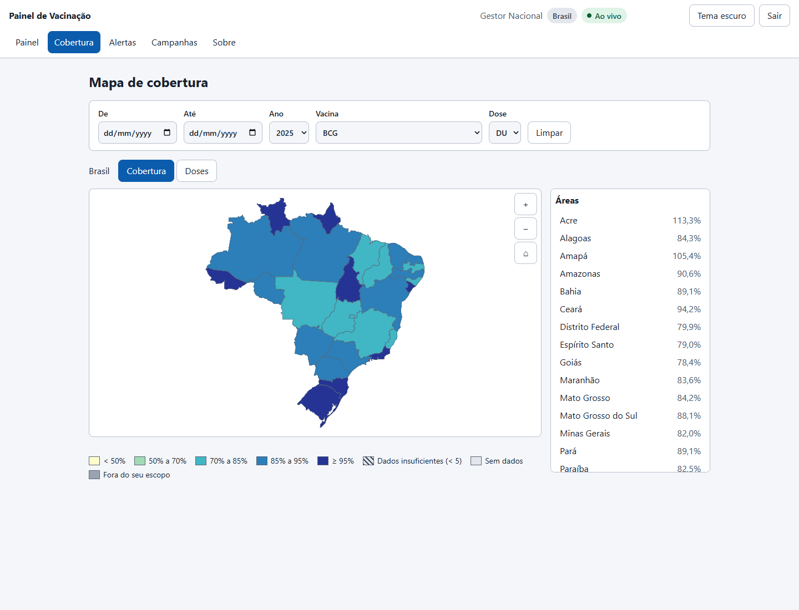
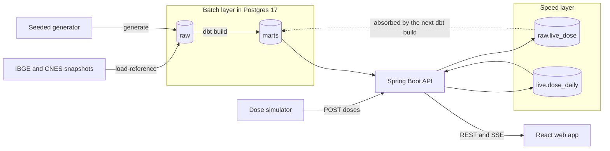
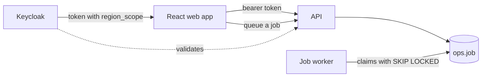
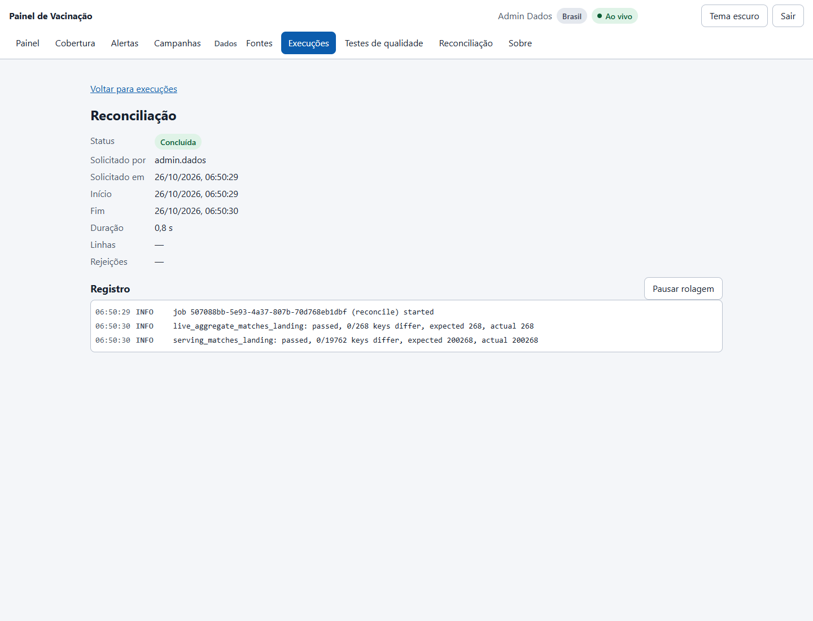
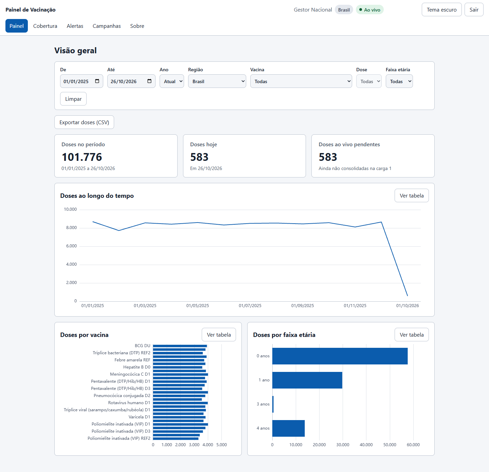
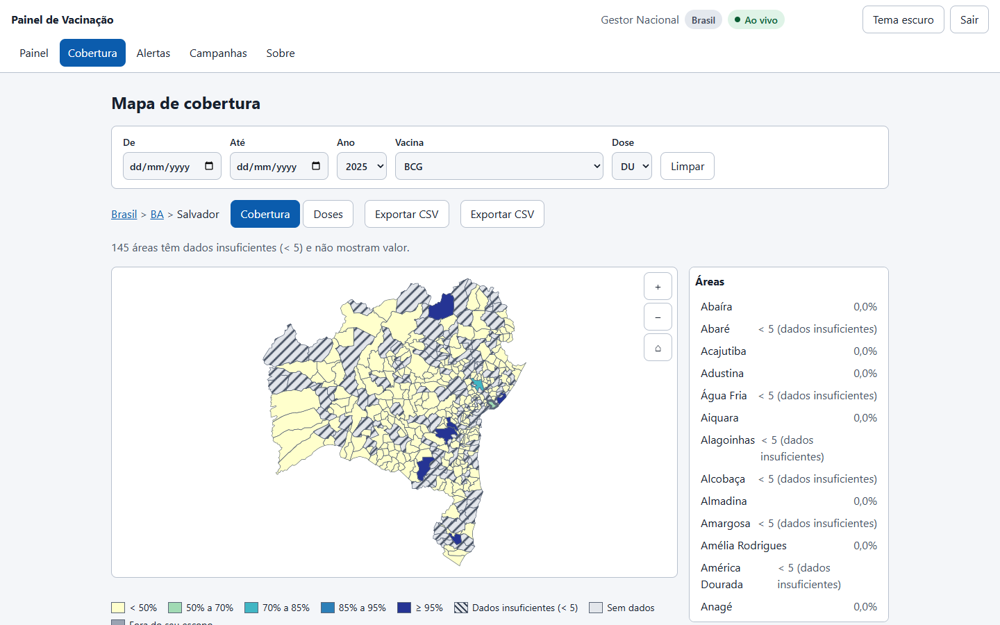
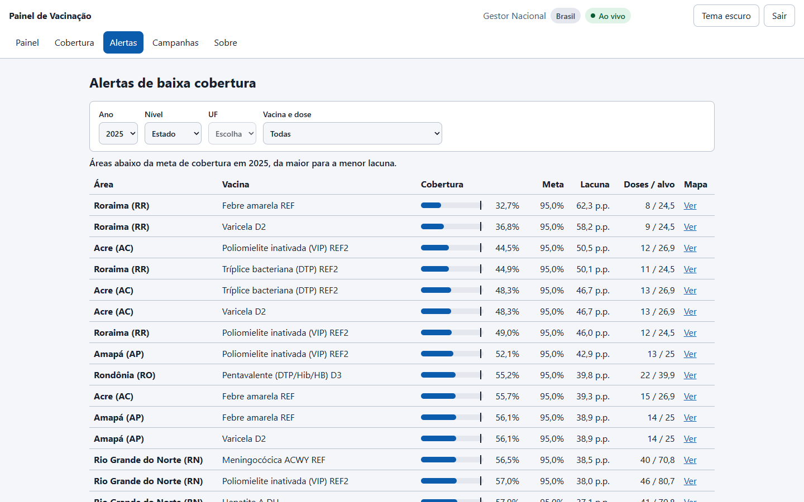
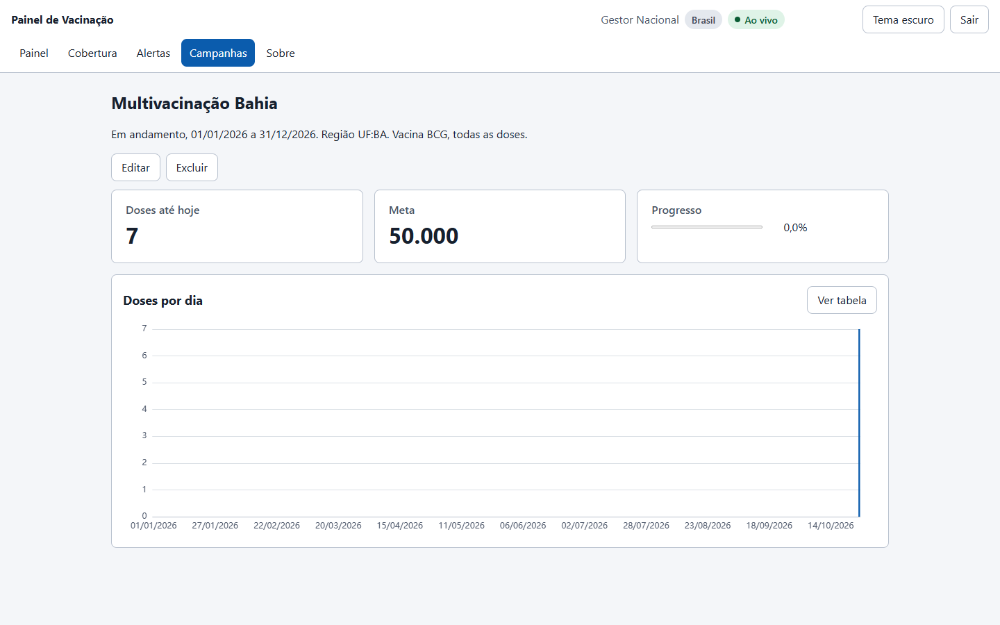
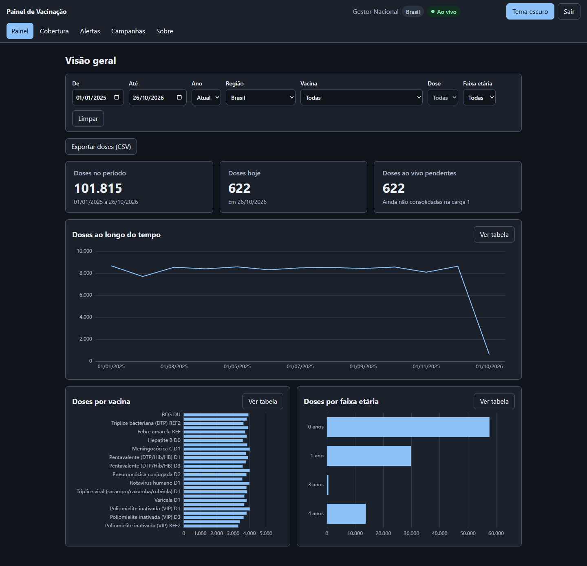

# Vaccine Warehouse

> A Kimball-style vaccination data warehouse (Postgres, Python ELT, dbt) for Brazilian childhood immunization, with a near-real-time speed layer and a role-scoped web dashboard. Reference data is public; doses are synthetic. The UI is in Portuguese.

[](https://github.com/emanuel-luis/vaccine-warehouse/actions/workflows/ci.yml)
[](LICENSE)



## What this demonstrates

- A generation watermark between the speed and batch layers. dbt builds the marts; the API adds the doses that arrived after the last build from a live aggregate, and the watermark keeps a dose from being counted twice or dropped while dbt absorbs it.
- Idempotent ingest. Each client sends an Idempotency-Key per dose; a replay returns the stored result, a reused key with a different payload is rejected, and invalid doses land in `ops.ingest_reject`.
- Reconciliation. `vaccine-elt reconcile` and a dbt singular test check the live aggregate and the serving merge against the landing tables.
- dbt contracts and tests. Enforced contracts on the marts and tests for keys, grains, age windows, dose order and SCD2 integrity, including point-in-time joins from each dose to the health unit version valid on its date.
- Reproducible inputs. Public snapshots are vendored with a sha256 manifest that is verified on load, and the synthetic generator is seeded, so the same command gives the same data.

Also in the web platform:

- OIDC login with a region scope on every endpoint
- Small-cell suppression: counts of 1 to 4 for municipalities and health units are hidden (k = 5)
- A typed client generated from the committed OpenAPI spec; CI fails when it drifts
- Async jobs claimed by a worker with `SKIP LOCKED`, with a live log
- Accessibility: keyboard drill-down on the map, text alternatives for charts, axe checks
- Playwright end-to-end tests in CI, signing in through the real Keycloak page

## Architecture



Access and data management run beside this flow:



## Tech stack

PostgreSQL 17, dbt-core 1.12, Python 3.12 (uv, psycopg 3, pytest, hypothesis, ruff, mypy), Java 21, Spring Boot 4.1 (JdbcClient, Flyway, OAuth2 resource server), Keycloak, React 19, TypeScript, Vite, TanStack Query, ECharts, MapLibre GL, Vitest, Playwright, axe-core, Docker Compose, nginx, GitHub Actions (OSV-Scanner, Dependabot).

## Quickstart

Prerequisites:

- Docker with Compose v2 and GNU Make
- bash and [uv](https://docs.astral.sh/uv/)
- Node 24 and `make web-install`, only for the Playwright tests and the screenshots
- On Windows, run everything inside WSL 2 with Docker Desktop's WSL integration
- Free ports 5432, 8080, 8081 and 8180

```bash
git clone https://github.com/emanuel-luis/vaccine-warehouse && cd vaccine-warehouse
make demo    # creates .env from .env.example if missing, then: stack, reference data,
             # 200k synthetic doses, dbt build, reconcile, API smoke test
```

`make demo` takes a few minutes on the first run. Open http://localhost:8081 and sign in with a demo user. All demo users share the password in `KC_DEMO_PASSWORD` in your `.env`. The simulator posts about 2 doses per second, so "Doses hoje" keeps moving. Keycloak runs at http://localhost:8180 and the API at http://localhost:8080. `make down` stops the stack and removes its volumes.

| User | Role | Scope |
| --- | --- | --- |
| `gestor.nacional` | manager | Brazil |
| `gestor.bahia` | manager | Bahia (UF:BA) |
| `profissional.bahia` | health professional | Bahia (UF:BA) |
| `profissional.salvador` | health professional | Salvador (MUN:2927408) |
| `admin.dados` | data administrator | Brazil |

Managers create campaigns and export CSV; professionals only read; the data administrator also gets the Data screens (sources, runs, quality tests, reconciliation).

## Screenshots

A data run with its live log. The worker streams the lines while the job runs:



The dashboard: KPI cards, doses over time, and doses by vaccine and by age band:



Drill-down to Salvador: the municipality is outlined on the map and its health units are listed below:



Low-coverage alerts, areas below the goal for each vaccine dose:



A campaign with its target, doses so far and daily doses:



The same dashboard in the dark theme:



## How real time works

The simulator posts synthetic doses to the API. Each dose is written in one transaction to `raw.live_dose` and to the `live.dose_daily` aggregate, and a Postgres `NOTIFY` wakes the API, which pushes events over server-sent events to every open browser. The pages refetch, so "Doses hoje" moves within seconds. When dbt builds, the `on-run-start` hook closes the current generation: the mart carries that generation as `batch_generation` and the API only adds live rows with a higher one, so the totals stay exact across the hand-over. `make speed-check` checks this end to end.

## Data and licensing

Reference data is public (IBGE Localidades, Censo 2022 via SIDRA, CNES extracts, attributed to IBGE and the Ministry of Health). Vaccination events, lots and receipts are synthetic, so no number here is real coverage.

`make demo` generates about 0.2% of a national birth cohort (`ops.load_run.sample_fraction` is 0.0018 with the default 200k rows; see [docs/data-model.md](docs/data-model.md)). Coverage denominators are scaled by that fraction. State-level coverage is close to the generator's take-up for the larger states, but small states such as Acre or Amapá can land above 100% from sampling noise. Municipality-level coverage is mostly noise: many small municipalities read 0% or are suppressed.

The coverage goals and the terms of use of the IBGE and CNES sources are still to be confirmed, see [docs/data-sources.md](docs/data-sources.md).

## Project structure

```
data/sources/          vendored public snapshots + sha256 manifest
elt/                   vaccine-elt: load-reference, generate, reconcile, simulate, worker (uv project)
dbt/                   staging, intermediate (SCD2), marts, seeds, data tests
src/main/java/...      Spring Boot API: analytics, dashboard, live, campaigns, exports, admin, security
src/main/resources/db/migration/   Flyway migrations (raw, ops, live, app)
web/                   React SPA, typed API client, Vitest tests, Playwright e2e (web/e2e)
keycloak/              realm with roles, clients and demo users
scripts/               smoke.sh and speed-check.sh
docs/                  plans, decisions, data model, data sources, OpenAPI spec, screenshots
compose.yaml  Dockerfile  Makefile  .github/workflows/ci.yml
```

## Development

```bash
make help          # every target
make lint          # Spotless, ruff, mypy, dbt parse (what CI runs)
make test          # Java and Python suites (Testcontainers, needs Docker)
make web-lint web-test web-build
make e2e           # Playwright against the running stack (make demo first)
make screenshots   # regenerate docs/screenshots from the running stack
make simulate      # run the dose simulator from the host
```

The e2e tests need the browser once: `cd web && npx playwright install chromium`.

More: [web platform plan](docs/WEB_PLATFORM_PLAN.md), [decisions](docs/DECISIONS.md), [data model](docs/data-model.md), [data sources](docs/data-sources.md).

## License

MIT, see [LICENSE](LICENSE).
