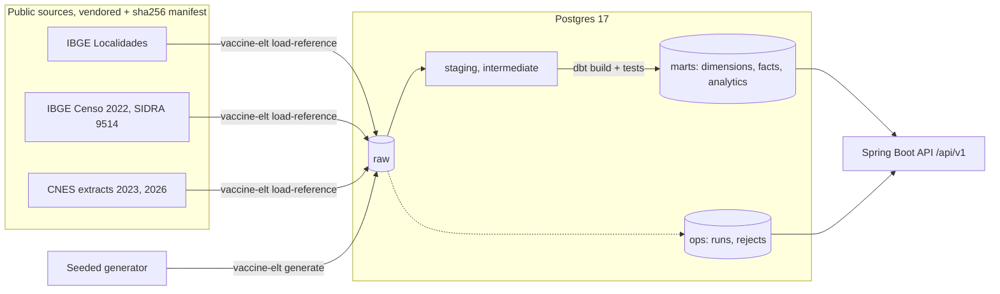

# Vaccine Backend: dimensional vaccination warehouse

> A Kimball-style warehouse of Brazilian childhood vaccination on Postgres: public IBGE and CNES
> reference data, a reproducible Python ELT, Flyway migrations, dbt marts with data tests, and a
> read-only Spring Boot API over the marts.

[](https://github.com/emanuel-luis/vaccine-backend/actions/workflows/ci.yml)
[](https://github.com/emanuel-luis/vaccine-backend/actions/workflows/security.yml)


## What this demonstrates

- **Dimensional modeling.** Conformed dimensions (`dim_date`, `dim_municipality`, `dim_vaccine`,
  `dim_vaccine_lot`, `dim_demographic` as a junk dimension), surrogate keys, Unknown members, and a
  type 2 slowly changing dimension for health units built deterministically from two dated CNES
  extracts. Contracts and grains in [docs/data-model.md](docs/data-model.md).
- **Facts with a declared grain.** `fact_vaccination` (one dose), `fact_vaccine_receipt` (one lot
  shipment) and `fact_population` (census), joined to the health-unit version valid on the event
  date, plus analytics marts: doses by state and month, by age band, and coverage against the
  census.
- **Reproducible ELT.** Public sources are vendored as normalized snapshots with a sha256 manifest.
  `load-reference` validates every row against a typed contract, records rejects, and replaces each
  raw table in one transaction (`TRUNCATE` + `COPY`), so reloads are idempotent. A seeded generator
  produces the synthetic events from the 2026 national childhood schedule; same seed, same rows.
- **Run metadata.** Every command writes a run, per-source row counts (read = loaded + rejected)
  and the rejected lines to the `ops` schema; the API exposes the latest runs.
- **Schema as code and data tests.** Flyway owns `raw` and `ops`; dbt owns `staging`,
  `intermediate`, `reference` and `marts`, with enforced contracts and tests for keys, grains, SCD2
  integrity, age windows, dose order, stock coverage and reconciliation with raw.
- **Tested end to end.** JUnit with Testcontainers, pytest with hypothesis and Testcontainers, and
  a CI job that brings the stack up, loads the data, runs `dbt build` and calls every endpoint.

## Architecture



## Tech stack

PostgreSQL 17 · dbt-core 1.12 + dbt-postgres · Python 3.12 (uv, psycopg 3, pytest, hypothesis,
ruff, mypy) · Java 21 · Spring Boot 4.1 (JdbcClient, Flyway) · Testcontainers · Docker Compose ·
GitHub Actions (OSV-Scanner, Dependabot)

## Quickstart

Needs Docker, GNU Make (Linux, macOS or WSL) and [uv](https://docs.astral.sh/uv/). JDK 21 is only
needed to run the Java tests.

```bash
git clone https://github.com/emanuel-luis/vaccine-backend && cd vaccine-backend
make demo   # .env, Postgres + API, reference data, 200k synthetic doses, dbt build, endpoint smoke
make down   # stop and remove the stack
```

`make demo` takes a few minutes on the first run (image build, dependencies). `make help` lists
every target; `make lint` runs exactly what the CI lint job runs; `make test` runs the Java and
Python suites with Testcontainers.

## API

Read-only, JSON. Lists come as `{"data": [...], "meta": {"source", "synthetic", "count"}}`; errors
are RFC 9457 problem details (400 for invalid parameters, 404 for an unknown unit, 503 while the
marts are not built).

| Endpoint | Returns |
| --- | --- |
| `GET /api/v1/doses/by-state-month?from=YYYY-MM&to=YYYY-MM[&state=SP][&vaccine=PENTA]` | doses per state, month, vaccine and dose (at most 36 months) |
| `GET /api/v1/doses/by-age-band?from=YYYY-MM&to=YYYY-MM[&state][&vaccine]` | doses per state, month, vaccine, sex and age in completed years |
| `GET /api/v1/coverage[?year=2024][&state][&vaccine]` | coverage of the indicator doses per state and year |
| `GET /api/v1/health-units/{cnesCode}/history` | every SCD2 version of a health unit |
| `GET /api/v1/runs/latest` | the latest run of each ELT command with its row counts |

```bash
curl "http://localhost:8080/api/v1/coverage?year=2024&state=SP&vaccine=PENTA"
curl "http://localhost:8080/api/v1/health-units/0000264/history"
```

Coverage divides synthetic doses by the Censo 2022 population of the target age, scaled by the
generator's sample fraction (method in [docs/data-model.md](docs/data-model.md)). It shows how the
warehouse computes the indicator; it is not real coverage.

## Project structure

```
data/sources/          vendored public snapshots + manifest.json
elt/                   vaccine-elt: fetch, load-reference, generate, contracts, run log (uv project)
dbt/                   staging, intermediate (SCD2, enrichment), marts, seeds, data tests
src/main/java/io/github/emanuelluis/vaccine/
  analytics/           doses and coverage endpoints (JdbcClient over the marts)
  units/  runs/        health-unit history, ELT runs
  web/                 response envelope, problem details
src/main/resources/db/migration/   Flyway migrations (ops, raw)
scripts/smoke.sh       end-to-end endpoint check used by make demo and CI
docs/                  plan, decisions, data model, data sources
compose.yaml  Dockerfile  Makefile
```

## Data and licenses

Reference data is public (IBGE, Ministry of Health); vaccination events, lots and receipts are
synthetic. Sources, citations and the status of their terms of use are in
[docs/data-sources.md](docs/data-sources.md). Code under the [MIT](LICENSE) license. How the
project got here: [docs/REFACTOR_PLAN.md](docs/REFACTOR_PLAN.md) and
[docs/DECISIONS.md](docs/DECISIONS.md).
