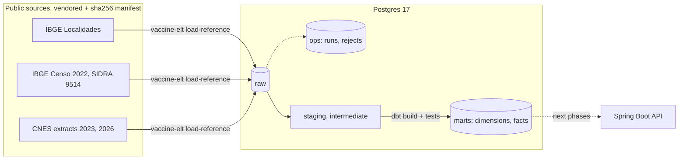

# Vaccine Backend: dimensional vaccination warehouse

> A Kimball-style warehouse of Brazilian childhood vaccination on Postgres: public IBGE and CNES
> reference data, a reproducible Python ELT, Flyway migrations, dbt marts with data tests, and a
> Spring Boot API.

[](https://github.com/emanuel-luis/vaccine-backend/actions/workflows/ci.yml)


> **Refactor in progress (phase 2 of 4).** Reference data, dimensions and SCD2 history are in
> place. The synthetic vaccination facts, the analytics marts and the new endpoints come in the
> next phases. Plan: [docs/REFACTOR_PLAN.md](docs/REFACTOR_PLAN.md); decisions:
> [docs/DECISIONS.md](docs/DECISIONS.md).

## What this demonstrates

- **Dimensional modeling.** Conformed dimensions (`dim_date`, `dim_municipality`, `dim_vaccine`,
  `dim_demographic` as a junk dimension), surrogate keys, Unknown members, a declared grain per
  fact, and a type 2 slowly changing dimension for health units built deterministically from two
  dated CNES extracts. Contracts and grain in [docs/data-model.md](docs/data-model.md).
- **Reproducible ELT.** Public sources are vendored as normalized snapshots with a sha256 manifest;
  `load-reference` validates every row against a typed contract, records rejects, and replaces
  each raw table in one transaction (`TRUNCATE` + `COPY`), so reloads are idempotent.
- **Run metadata.** Every load writes a run, per-source row counts (read = loaded + rejected) and
  the rejected lines to the `ops` schema.
- **Schema as code.** Flyway owns `raw` and `ops`; dbt owns `staging`, `intermediate` and `marts`
  (enforced contracts, 66 data tests including SCD2 integrity and reconciliation with raw).
- **Tested end to end.** Testcontainers for Java and Python, and a CI job that brings the stack up,
  loads the data and runs `dbt build`.

## Architecture



## Tech stack

PostgreSQL 17 · dbt-core 1.12 + dbt-postgres · Python 3.12 (uv, psycopg 3, pytest, hypothesis,
ruff, mypy) · Java 21 · Spring Boot 4.1 · Flyway · Testcontainers · Docker Compose · GitHub Actions

## Quickstart

Needs Docker, GNU Make (Linux, macOS or WSL) and [uv](https://docs.astral.sh/uv/). JDK 21 is only
needed to run the Java tests.

```bash
git clone https://github.com/emanuel-luis/vaccine-backend && cd vaccine-backend
make demo   # .env from .env.example, Postgres + API up, reference data loaded, dbt build
make down   # stop and remove the stack
```

`make demo` takes a few minutes on the first run (image build, dependencies). Then, for example:

```bash
docker compose exec postgres psql -U vaccine -d vaccine -c \
  "select cnes_code, unit_name, is_active, valid_from, valid_to
   from marts.dim_health_unit where cnes_code = '0000264' order by valid_from"
```

`make help` lists every target. `make lint` runs exactly what the CI lint job runs; `make test`
runs the Java and Python suites with Testcontainers.

## Project structure

```
data/sources/         vendored public snapshots + manifest.json
elt/                  vaccine-elt: fetch, load-reference, contracts, run log (uv project)
dbt/                  staging, intermediate (SCD2), marts, seeds, data tests
src/main/resources/db/migration/   Flyway migrations (ops, raw, legacy schema)
src/main/java/...     Spring Boot API (legacy endpoints until phase 4)
src/python/           legacy CSV loaders for the legacy endpoints (removed in phase 4)
docs/                 plan, decisions, data model, data sources
compose.yaml  Dockerfile  Makefile
```

## Data and licenses

Reference data is public (IBGE, Ministry of Health); vaccination events will be synthetic. Sources,
citations and the status of their terms of use are in [docs/data-sources.md](docs/data-sources.md).
Code under the [MIT](LICENSE) license.
