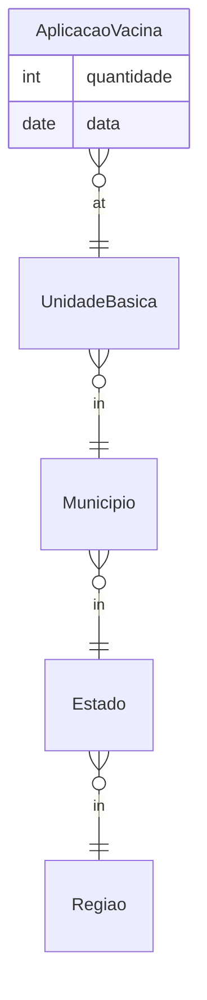

# Vaccine Backend — Dimensional Data Warehouse

> A vaccination analytics API backed by a **star schema** (dimension + fact tables), built with
> **Spring Boot**, with SQL DDL and Python-generated seed data.

[](https://github.com/emanuel-luis/vaccine-backend/actions/workflows/ci.yml)


> **Refactor in progress.** The repo is being rebuilt into a Kimball warehouse with Flyway, dbt
> marts and analytical endpoints, in phases. Plan: [docs/REFACTOR_PLAN.md](docs/REFACTOR_PLAN.md);
> decisions: [docs/DECISIONS.md](docs/DECISIONS.md).

## What this demonstrates

- **Dimensional modeling (Kimball)** — an explicit **star schema**: a `AplicacaoVacina`
  (vaccine-application) **fact** surrounded by geographic/organizational **dimensions**
  (Estado, Município, Região, Unidade Básica).
- **Data warehouse fundamentals** — fact/dimension separation, conformed geographic hierarchy,
  and versioned SQL DDL (Flyway).
- **Seed / synthetic data generation** — Python generators (`generate_aplicacao_vacina.py`,
  `mock_data.py`) plus CSV dimension seeds.
- **Analytics API** — Spring Boot controllers/services exposing fact and dimension queries.

## Star schema



`AplicacaoVacina` = fact (measures); `Estado / Municipio / Regiao / UnidadeBasica` = dimensions.

## Tech stack

Java 21 · Spring Boot 4.1 · Flyway · PostgreSQL 17 · Testcontainers · Maven · Docker Compose ·
GitHub Actions · Python (data loading).

## Quickstart

Needs Docker, GNU Make and [uv](https://docs.astral.sh/uv/) (JDK 21 only for running tests).

```bash
git clone https://github.com/emanuel-luis/vaccine-backend && cd vaccine-backend
make demo   # creates .env from .env.example, starts Postgres + API, loads the dimension CSVs
curl "http://localhost:8080/api/dimension?size=5"
make down   # stop and remove the stack
```

Flyway creates the schema when the API starts; configuration comes from the environment
(`.env.example`). `make help` lists every target; `make test` runs the Testcontainers suite.

## Project structure

```
src/main/java/io/github/emanuelluis/vaccine/
  api/dimension/          # Estado, Municipio, Regiao, UnidadeBasica (+ repositories)
  api/fact/               # AplicacaoVacina (+ repository, service, controller)
src/main/resources/db/migration/   # Flyway migrations
src/python/
  data/                   # estado.csv, municipio.csv, regiao.csv, unidade_basica.csv
  generate_aplicacao_vacina.py  mock_data.py
compose.yaml  Dockerfile  Makefile
```

## License

[MIT](LICENSE)
