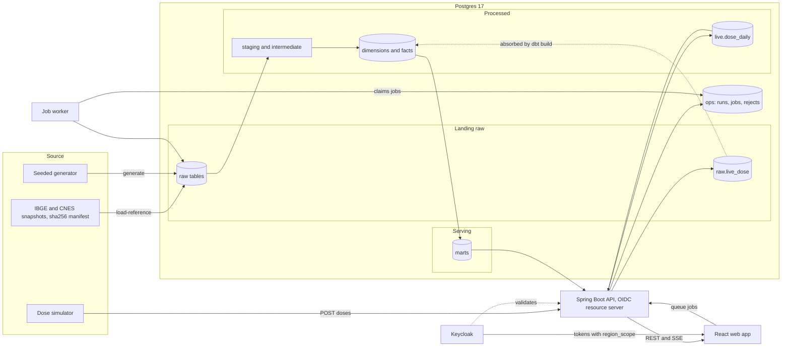
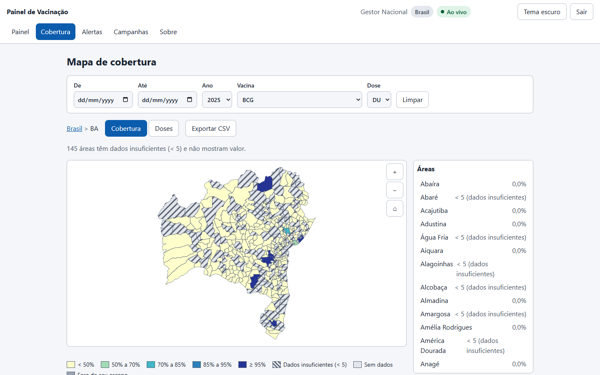

# Vaccine Warehouse

> A vaccination warehouse for Brazilian childhood immunization with a live dashboard on top: a Kimball-style batch layer, a Postgres speed layer that shows new doses within seconds, region-scoped access through OIDC, and a React web app.

[](https://github.com/emanuel-luis/vaccine-warehouse/actions/workflows/ci.yml)
[](LICENSE)


## What this demonstrates

- Speed and batch layers over one Postgres. dbt builds the marts (batch); the API adds the doses that arrived after the last build from a live aggregate, using a generation watermark so a dose is never counted twice or dropped while dbt absorbs it.
- Idempotent ingest. Doses are posted once per transaction (raw row plus live aggregate); invalid ones land in a reject table. Reloads of reference data are `TRUNCATE` + `COPY` in one transaction.
- Reconciliation. `vaccine-elt reconcile` and a dbt singular test prove that marts plus live rows equal the landing tables.
- dbt contracts and tests. Enforced contracts on the marts, tests for keys, grains, SCD2 integrity, age windows and dose order.
- OIDC with region scoping. Keycloak issues tokens with a `region_scope` claim; every endpoint filters by it through one guard, and URL roles live in one place.
- Small-cell suppression. Counts of 1 to 4 for municipalities and health units are hidden (k = 5) in the API and the exports, and the UI shows "< 5".
- Typed client from OpenAPI. The spec is committed, a test keeps it in sync with the controllers and CI fails when the generated client drifts.
- Async jobs with `SKIP LOCKED`. A data admin reloads reference data, runs dbt or reconciles from the UI; a worker claims jobs and streams its log lines to the page.
- Accessible by construction. Keyboard drill-down on the map, text alternatives for charts, and axe checks with no serious or critical violations.
- Browser end to end in CI. Playwright signs in through the real Keycloak page and exercises the dashboards, scoping, campaigns and data admin against the full compose stack.

## Architecture



## Tech stack

PostgreSQL 17, dbt-core 1.12, Python 3.12 (uv, psycopg 3, pytest, hypothesis, ruff, mypy), Java 21, Spring Boot 4.1 (JdbcClient, Flyway, OAuth2 resource server), Keycloak, React 19, TypeScript, Vite, TanStack Query, ECharts, MapLibre GL, Vitest, Playwright, axe-core, Docker Compose, nginx, GitHub Actions (OSV-Scanner, Dependabot).

## Quickstart

Needs Docker, GNU Make (Linux, macOS or WSL) and [uv](https://docs.astral.sh/uv/).

```bash
git clone https://github.com/emanuel-luis/vaccine-warehouse && cd vaccine-warehouse
cp .env.example .env     # local-only placeholder secrets; edit if you like
make demo                # stack, reference data, 200k synthetic doses, dbt build, reconcile, API smoke
```

Open http://localhost:8081 and sign in with a demo user. All demo users share the password in `KC_DEMO_PASSWORD` in your `.env`.

| User | Role | Scope |
| --- | --- | --- |
| `gestor.nacional` | manager | Brazil |
| `gestor.bahia` | manager | Bahia (UF:BA) |
| `profissional.bahia` | health professional | Bahia (UF:BA) |
| `profissional.salvador` | health professional | Salvador (MUN:2927408) |
| `admin.dados` | data administrator | Brazil |

Managers create campaigns and export CSV; professionals only read; the data administrator also gets the Data screens (sources, runs, quality tests, reconciliation). Other endpoints: Keycloak at http://localhost:8180, API at http://localhost:8080.

`make demo` takes a few minutes on the first run. `make down` stops the stack and removes its volumes. On Windows run the make targets from WSL.

## Screenshots

| Coverage map of Bahia | Salvador health units |
| --- | --- |
|  |  |

| Low-coverage alerts | Campaign progress |
| --- | --- |
|  |  |

| Data run with live log | Dark theme |
| --- | --- |
|  |  |

## How real time works

The simulator posts synthetic doses to the API. Each dose is written in one transaction to `raw.live_dose` and to the `live.dose_daily` aggregate, and a Postgres `NOTIFY` wakes the API, which pushes events over server-sent events to every open browser. The pages refetch, so "Doses today" moves within seconds. When dbt builds, the `on-run-start` hook closes the current generation: the mart carries that generation as `batch_generation` and the API only adds live rows with a higher one, so the totals stay exact across the hand-over. `make speed-check` proves it end to end.

## Data and licensing

Reference data is public (IBGE Localidades, Censo 2022 via SIDRA, CNES extracts, attributed to IBGE and the Ministry of Health); vaccination events, lots and receipts are synthetic, so no number here is real coverage. The exact terms of use of the public sources are to be confirmed, see [docs/data-sources.md](docs/data-sources.md). Code is under the [MIT](LICENSE) license.

## Project structure

```
data/sources/          vendored public snapshots + sha256 manifest
elt/                   vaccine-elt: load-reference, generate, reconcile, simulate, worker (uv project)
dbt/                   staging, intermediate (SCD2), marts, seeds, data tests
src/main/java/...      Spring Boot API: analytics, dashboard, live, campaigns, exports, admin, security
src/main/resources/db/migration/   Flyway migrations (raw, ops, live, app)
web/                   React SPA, typed API client, Vitest tests, Playwright e2e (web/e2e)
keycloak/              realm with roles, clients and demo users
scripts/               smoke.sh and speed-check.sh
docs/                  plans, decisions, data model, data sources, OpenAPI spec, screenshots
compose.yaml  Dockerfile  Makefile  .github/workflows/ci.yml
```

## Development

```bash
make help          # every target
make lint          # Spotless, ruff, mypy, dbt parse (what CI runs)
make test          # Java and Python suites (Testcontainers, needs Docker)
make web-lint web-test web-build
make e2e           # Playwright against the running stack (make demo first)
make screenshots   # regenerate docs/screenshots from the running stack
make simulate      # run the dose simulator from the host
```

The e2e tests need the browser once: `cd web && npx playwright install chromium`.

More: [web platform plan](docs/WEB_PLATFORM_PLAN.md), [decisions](docs/DECISIONS.md), [data model](docs/data-model.md), [data sources](docs/data-sources.md).
