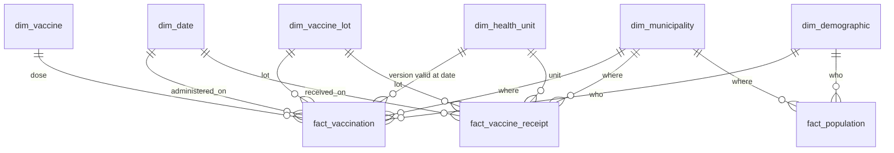

# Refactor plan: vaccination data warehouse

Status: approved by the repo lead on 2026-10-25. Source: `architect` blueprint, with the lead's
adjustments listed first. Decisions are logged in [DECISIONS.md](DECISIONS.md).

## Lead adjustments to the blueprint

- **Single Flyway runner = the API.** No one-shot `migrate` service in compose (one-shot services
  break `docker compose up --wait`). The ELT container waits for the API to be healthy, which
  implies the migrations ran. Tests and IDE runs migrate the same way.
- File names: `compose.yaml`, `application.yml`.
- **ELT runs on the host through uv**, not in an `elt` container: `make demo` maps `.env` to the
  libpq `PG*` variables and runs `uv run --project elt vaccine-elt ...` and dbt against the compose
  Postgres. One Dockerfile, no compose profile; CI installs uv anyway. The Python project lives in
  `elt/` (its own `pyproject.toml` and `uv.lock`; dbt-core and dbt-postgres in a `dbt` group).
- Legacy endpoints and the `src/python` loaders stay until PR4 replaces the API, so `main` keeps a
  working demo after every phase; a PR4 migration drops the legacy tables.
- PR1 already ships Flyway `V1` (the legacy operational schema in `public`, history in `ops`),
  so the warehouse migrations start at `V2`. Legacy tables are dropped by a later migration when
  the legacy endpoints go away.
- CI exists from PR1 (lint, `mvn verify`, compose smoke) so every PR has a merge gate; PR4 extends
  it with the Python and dbt jobs, `security.yml` and Dependabot.

## Goal and done-criteria

Compose brings up Postgres + the API; one command loads dimensions from public sources and
generates a bounded synthetic fact set; dbt marts answer coverage questions; CI is green.

## Layering

| Schema | Owner | Contents |
| --- | --- | --- |
| `ops` | Flyway | `flyway_schema_history`, `load_run`, `load_run_table`, `load_reject` |
| `raw` | Flyway (DDL), Python ELT (rows) | landed reference data and synthetic events; typed, with PKs and `run_id` |
| `staging` | dbt | views: rename, cast, map codes |
| `intermediate` | dbt | views: SCD2 versioning, event enrichment |
| `marts` | dbt | tables with enforced contracts: dimensions, facts, analytics marts |

- The API reads `marts` with `JdbcClient` + Java records (read-only). dbt drops and swaps mart
  tables, so JPA entities would couple startup validation to dbt runs. JPA, Lombok and Mustache
  are removed in PR4.
- Missing marts (SQLState `42P01`) return 503 problem+json "marts not built: run `make demo`";
  the app still starts and stays healthy.

## Dimensional model

Grains:
- `fact_vaccination`: one dose given to one synthetic person at one unit on one date.
- `fact_vaccine_receipt`: one lot shipment received by one unit on one date.
- `fact_population`: municipality x sex x single-year age (0-6) x census year.
- `dim_vaccine`: vaccine x dose in the PNI childhood schedule.
- `dim_health_unit`: CNES code x version (SCD2).

Model decisions:
- Geography is flattened: `dim_municipality` carries state and region (about 5,571 rows; a
  snowflake buys nothing). Facts carry both `health_unit_key` and `municipality_key`.
- Lot is its own dimension (`dim_vaccine_lot`), shared by receipts and applications.
- No patient dimension: a junk dimension `dim_demographic` (sex x completed-year age band 0-6,
  14 rows) whose bands match the census buckets; `person_id` is a degenerate key in the fact.
- Surrogate keys: `md5(natural key)::uuid` via `dbt_utils.generate_surrogate_key`, stable across
  rebuilds; every dimension has an Unknown row; `dim_date` uses integer `yyyymmdd`.
- Contracts enforce types, `not_null` and `primary_key`; foreign keys are `relationships` tests
  (dbt's drop-and-swap would drop real FK constraints); each fact indexes every FK column.
- SCD2 is a model over dated extracts, not a `dbt snapshot` (snapshots stamp run time and are not
  reproducible). `int_health_unit_versions` reads `raw.cnes_unit_snapshot` keyed by
  `(snapshot_date, cnes_code)` and emits `valid_from` / `valid_to` (exclusive, `9999-12-31`) and
  `is_current`. Tracked: `unit_name`, `neighborhood`, `municipality_ibge_code`, `is_active`.
  Street stays type-1 (its format differs between extracts). Deterministic demo: the repo's 2023
  CSV becomes snapshot `2023-06-02`, compared with a current CNES extract.
- Inventory periodic snapshot: deferred.

## Data sources

Vendored small normalized snapshots in `data/sources/` (about 3 MB gzipped) with
`manifest.json` (url, license_note, citation, retrieved_at, source_last_modified, sha256, rows).
`load-reference` verifies each sha256 and fails on mismatch. `fetch` refreshes files and manifest;
it runs by hand or from a `workflow_dispatch` job, never in CI.

| Source | Endpoint | Notes |
| --- | --- | --- |
| IBGE Localidades | `https://servicodados.ibge.gov.br/api/v1/localidades/municipios?view=nivelado` | JSON, 5,571 municipalities with state and region |
| Censo 2022, SIDRA table 9514 | `https://apisidra.ibge.gov.br/values/t/9514/n6/all/v/93/p/2022/c2/{4,5}/c287/6557,...,6563/c286/113635` | population by sex and age 0-6; 50,000-value cap per call, so one call per sex |
| CNES establishments | `https://s3.sa-east-1.amazonaws.com/ckan.saude.gov.br/CNES/cnes_estabelecimentos_csv.zip` | 57 MB zip, `;`-separated Latin-1; primary care = `TP_UNIDADE in (1,2)`; drop phone, email, CNPJ |

To verify in PR2 before vendoring: license / terms text of each source, CNES type labels, and the
PNI calendar age windows against the Ministry of Health's official calendar. Boa Esperança do
Norte (MT, 5101837) has no Censo 2022 row: its denominator is null and the coverage mart excludes
it.

## PR2: migrations, reference path, dimensions

- `V2__ops_run_metadata.sql`: `ops.load_run`, `ops.load_run_table`, `ops.load_reject`.
- `V3__raw_reference.sql`: `raw.ibge_municipality`, `raw.ibge_census_population`,
  `raw.cnes_unit_snapshot` (PK `snapshot_date, cnes_code`).
- `V4__raw_synthetic.sql`: `raw.vaccine_lot`, `raw.vaccination_event`, `raw.vaccine_receipt`.
- `data/sources/` snapshots + manifest; the legacy `src/python/` goes away.
- `elt/` uv package (Python 3.12, `psycopg[binary]`): `cli.py`, `manifest.py`, `sources/ibge.py`,
  `sources/cnes.py`, `load.py` (one transaction per table: TRUNCATE, `COPY`, counts),
  `runlog.py`. Connection from libpq `PG*` variables.
- `dbt/`: project, `profiles.yml` (env_var only), `packages.yml` (dbt_utils pinned),
  `generate_schema_name` macro, seeds `pni_child_schedule.csv` (with `source_url`) and
  `age_bands.csv`, staging, `int_health_unit_versions`, `dim_{date,municipality,health_unit,
  vaccine,demographic}`, `fact_population`.
- `docs/data-model.md`: ERD, grains, SCD2 rules and the column contracts of the three analytics
  marts (frozen here so PR3 and PR4 can proceed in parallel).

## PR3: generator, facts, marts

- `generate --rows N --seed S --start 2024-01-01 --end 2025-12-31`: `random.Random(seed)`,
  `uuid5` ids, never `now()`. Municipality weighted by census population under 1 (municipalities
  without units dropped), unit uniform among active units, sex by census ratio, birth date uniform.
  Per dose: seeded take-up with dropout, date = birth + recommended age + lateness, clipped to the
  age window and the minimum interval. Stops at exactly `--rows`.
- Receipts derived per unit x vaccine x month: applied x (1 + seeded 5-15% wastage), rounded up to
  pack size, received on the month's first business day; one synthetic lot per vaccine per quarter.
- `sample_fraction = persons per birth year / national age-0 population` recorded in
  `ops.load_run`. Reload is one transaction (TRUNCATE + `COPY`); same seed, identical rows.
- dbt: `stg_synthetic__*`, `int_vaccinations_enriched` (point-in-time join to the unit version),
  `dim_vaccine_lot`, `fact_vaccination`, `fact_vaccine_receipt`, and analytics marts
  `mart_doses_by_state_month`, `mart_doses_by_age_band`, `mart_coverage_by_state`.
- Coverage = 100 x indicator doses in the year to children of the target age / (Censo 2022
  population of that age in the state x sample_fraction). The official indicator uses SINASC live
  births; ours uses a constant census denominator, and every row says the numerator is synthetic.
- Tests: generic tests on every key, `unique_combination_of_columns` on fact grains, singular
  tests `dose_within_age_window`, `dose_sequence_ordered`, `receipts_cover_applications`,
  `scd2_no_overlap_one_current`, `fact_unit_version_valid_at_date`,
  `coverage_denominator_positive`.

## PR4: API, tests, CI, docs

- Endpoints (`{data: [...], meta: {source, synthetic: true}}`, validated params):
  `GET /api/v1/doses/by-state-month`, `GET /api/v1/doses/by-age-band`, `GET /api/v1/coverage`,
  `GET /api/v1/health-units/{cnesCode}/history`, `GET /api/v1/runs/latest`. Drop
  `/api/dimension*`, `/api/fact`, the Mustache page and the hardcoded CORS origin.
- Java tests: surefire unit tests; failsafe `*IT` with Testcontainers; mart fixtures in
  `src/test/resources/fixtures/marts.sql` matching `docs/data-model.md`.
- Python tests: pytest + hypothesis (row count, age windows, dose order, receipts cover
  applications, same seed same sha256); `db` marker with testcontainers-python; `external` marker
  deselected.
- CI: lint (spotless, ruff, mypy, `dbt parse`) gates `java`, `python` and `e2e` (compose up, ELT
  demo with `--rows 20000 --seed 42` including `dbt build`, curl every endpoint, upload dbt docs).
  `security.yml` and Dependabot (maven, uv, actions).
- Compose: `postgres`, `api`, `elt` (profile `tools`). `make demo` = up + `compose run elt demo`.
- Docs: README with the data-flow diagram, `docs/data-sources.md`, CHANGELOG, CLAUDE.md.

## Risks

- Mart fixture DDL could drift from dbt contracts: the e2e job on real marts catches it.
- `dbt build` drop-and-swap can briefly return 503s; acceptable locally.
- Government endpoints are slow or capped; CI never calls them.
- PNI age windows, license texts and CNES type labels need verification (PR2).
- The 2023 snapshot's provenance is approximate (documented as such).
