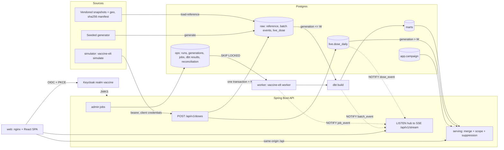

# Web platform plan: real-time vaccination dashboards

Status: blueprint from the `architect` review, 2026-10-25, amended by the repo lead (amendments
are marked "Lead:"). Decisions start at 25 in [DECISIONS.md](DECISIONS.md). Items marked
**check** are implementation details to confirm while coding. They do not reopen the design.

## Conflicts and repo facts that shape the design

1. CLAUDE.md says "The API is read-only and only reads `marts` and `ops`". The brief replaces that
   rule; the new wording is in section 14.
2. Decision 12 (the ELT runs on the host) is amended, not dropped. The host `make` targets stay,
   and a worker container runs the same package for jobs started from the UI (decision 37).
3. CLAUDE.md says "No credentials in the repo", but the brief wants demo users. The realm export
   uses Keycloak environment placeholders, so passwords and client secrets live only in `.env`
   (section 6).
4. `dbt/tests/marts_reconcile_with_raw.sql` and `receipts_cover_applications.sql` assume every
   dose is a generator event. Both would fail once live doses are absorbed, so PR1 changes them.
5. `.dockerignore` is a root allowlist for the API image. The new images use per-Dockerfile ignore
   files (`elt/Dockerfile.dockerignore`, `web/Dockerfile.dockerignore`), with the build context at
   the repo root.
6. `vaccine_elt.config.REPO_ROOT` is `parents[3]` of the module. The worker image must keep the
   repo layout (`/app/elt`, `/app/dbt`, `/app/data/sources`) and install the project in editable
   mode (uv's default).
7. `manifest.SourceEntry.table` is a required `str`. Geometry files have no table, so the field
   becomes `str | None`. `load_reference` already selects entries by table, and `verify()` checks
   every entry's sha256.
8. Sparsity (an estimate to measure in PR4): at `ROWS=200000`, most municipality x vaccine-dose x
   year cells get fewer than 5 doses. With k = 5, the municipality coverage map will be mostly
   suppressed outside large cities (section 13).

## 1. Goals and non-goals

Goals:
- SUS health agents, doctors and campaign managers get pt-BR dashboards that update within
  seconds while a simulator registers synthetic doses.
- Data admins manage reference reloads, dbt builds, quality results and reconciliation from the UI.
- The repo still reads as data engineering: explicit layers, idempotent steps, typed contracts, run
  metadata and one-command reproducibility.

Non-goals: real SI-PNI integration, real patient data, mobile apps, cloud deployment, message
brokers, extra microservices, dose-level screens, stock tracking for live doses.

## 2. Architecture

| Layer | Batch path | Speed path | Owner |
| --- | --- | --- | --- |
| Source | vendored IBGE/CNES snapshots and geometries, seeded generator | simulator (SI-PNI-like feed, synthetic) | `elt/` |
| Landing | `raw.*` (TRUNCATE + COPY) | `raw.live_dose` (append-only, idempotent POST) | Flyway DDL |
| Processed | dbt `staging`, `intermediate`, facts | `live.dose_daily` (incremental aggregate, same transaction as landing) | dbt / API |
| Serving | dbt `marts` | API merge: marts plus unabsorbed live generations, region scope, suppression | API |



## 3. Data contracts

### 3.1 Speed layer vs batch layer: the generation protocol

- Every live dose lands with the open **generation** G, read inside its insert transaction.
- `ops.close_live_generation(closed_by)` runs `LOCK TABLE raw.live_dose IN SHARE MODE`, bumps G
  by one, records the closed value W and returns it.
- An ingest transaction starts with `LOCK TABLE raw.live_dose IN ROW EXCLUSIVE MODE` and only then
  reads G. SHARE conflicts with ROW EXCLUSIVE, and table-lock waiters queue fairly. So the close
  waits for every in-flight ingest and blocks new ones until it commits. After the close commits,
  every row with `generation <= W` is committed, and no later row can get one. Readers (ACCESS
  SHARE) are never blocked.
- dbt closes a generation once per invocation in `on-run-start`:
  `select ops.close_live_generation('{{ invocation_id }}')`. Lead: the hook runs only when
  `flags.WHICH` is `run` or `build`, so `dbt test`, `parse`, `compile` and `docs generate` never
  close a generation that no model absorbs. The batch absorbs `raw.live_dose` rows with
  `generation <= max(ops.live_generation_close.generation)`.
- W propagates by `ref`: `int_vaccinations_enriched` attaches `batch_generation` to every row from
  the same CTE that filters the live rows. `fact_vaccination` stores it, and `mart_doses_daily`
  copies it. Because each table is built by one CTAS statement, the W in a mart always matches the
  doses inside it, even if another close happens mid-run.
- Serving merge, one SQL statement, so one snapshot. A mart swap is atomic, so there is no double
  count or gap, even during a dbt build:

```sql
with w as (select coalesce((select batch_generation from marts.mart_doses_daily limit 1), 0) as g),
merged as (
  select date_day, state_abbr, municipality_code, cnes_code, vaccine_code, dose_label, age_band_years, doses
  from marts.mart_doses_daily where /* region + filters */
  union all
  select l.administered_on, l.state_abbr, l.municipality_code, l.cnes_code, l.vaccine_code,
         l.dose_label, l.age_band_years, l.doses
  from live.dose_daily l cross join w where l.generation > w.g and /* region + filters */)
select ... from merged group by ...
```

  An empty mart with `coalesce(..., 0)` is still exact: every committed row with
  `generation <= W` is absorbed by the build that closed W, so an empty mart means no such row
  exists.
- Why one incremental aggregate, at grain generation x day x CNES unit x vaccine x dose x age
  band: it is the finest grain any dashboard filters on (period by day, unit drill-down, age band).
  It matches `mart_doses_daily` exactly, so every rollup (time series, by vaccine, by age band,
  map, units, campaign progress, coverage numerators) reuses one merge. `generation` in the key
  lets serving skip absorbed doses. Sex, lot and person are dropped because no dashboard uses them.
  Pruning absorbed generations is deferred (volume is bounded by demo length; risk 6).
- **check:** confirm that dbt-postgres commits `on-run-start` immediately. If not, the SHARE lock
  would stall ingest for the whole run; fall back to `transaction: false` or an explicit `commit`.

### 3.2 Flyway migrations (V6+)

| Version | PR | Contents |
| --- | --- | --- |
| `V6__live_ingest.sql` | 1 | schema `live`; `ops.live_generation` (single row `id = 1`, `generation bigint`, seeded 1); `ops.live_generation_close` (`generation` PK, `closed_at`, `closed_by`); `raw.live_dose`; `live.dose_daily`; `ops.ingest_reject`; function `ops.close_live_generation(text)` |
| `V7__reconciliation.sql` | 1 | `ops.reconciliation_check`, `ops.reconciliation_diff` |
| `V8__campaigns.sql` | 5 | schema `app`; `app.campaign` |
| `V9__jobs_and_dbt_results.sql` | 6 | `ops.job`, `ops.job_log`, `ops.dbt_invocation`, `ops.dbt_node_result`, `ops.load_run_source` |

Key tables:
- `raw.live_dose`: `event_id uuid` PK (server-generated), `generation bigint`, `client_id text`,
  `idempotency_key text`, `request_sha256 char(64)`, `person_id uuid`, `birth_date date`,
  `sex char(1)` F/M, `cnes_code char(7)`, `vaccine_code`, `dose_label`, `lot_number` (nullable),
  `administered_at timestamptz`, `received_at timestamptz`.
  - Unique: (`client_id`, `idempotency_key`) and (`person_id`, `vaccine_code`, `dose_label`).
    Index on `generation`.
- `live.dose_daily`: PK (`generation`, `administered_on`, `cnes_code`, `vaccine_code`,
  `dose_label`, `age_band_years` 0-6).
  - Columns: `municipality_code int`, `state_abbr char(2)` (from the unit version valid on the
    date), `doses bigint > 0`, `updated_at`.
  - Indexes: (`state_abbr`, `administered_on`), (`municipality_code`, `administered_on`).
- `ops.ingest_reject`: identity PK, `received_at`, `client_id`, `idempotency_key`, `http_status`,
  `reason` code, `detail`. No payload is stored. Index on `received_at`.
- `ops.reconciliation_check`: PK (`run_id` -> `ops.load_run`, `check_name`), `batch_generation`,
  `open_generation`, `keys_compared`, `keys_mismatched`, `expected_total`, `actual_total`,
  `passed`.
- `ops.reconciliation_diff`: (`run_id`, `check_name`, `line_no`) PK, `diff_key jsonb`, `expected`,
  `actual`. At most 100 rows per check.
- `app.campaign`: `campaign_id uuid` PK, `name`, `vaccine_code`, `dose_label` (null = all doses),
  `region_scope` (same syntax as the claim), `starts_on`, `ends_on` (CHECK `>= starts_on`),
  `target_doses int > 0`, `created_by`, `created_at`, `updated_at`, `version int` (optimistic
  lock).
- `ops.job`: `job_id uuid` PK, `kind` (`load-reference` | `dbt-build` | `reconcile`), `status`
  (`queued` | `running` | `succeeded` | `failed`), `requested_by`, `requested_at`, `started_at`,
  `finished_at`, `heartbeat_at`, `worker_id`, `run_id` (-> `load_run`, nullable),
  `dbt_invocation_id`, `error`.
  - `CREATE UNIQUE INDEX ux_job_single_active ON ops.job ((1)) WHERE status IN ('queued','running')`
    makes one job at a time a database rule.
- `ops.job_log`: PK (`job_id`, `seq`), `logged_at`, `level`, `message` (2,000 characters max, 5,000
  lines per job).
- `ops.dbt_invocation`: `invocation_id` PK, `job_id`, `command`, `generated_at`, `elapsed_s`,
  `dbt_version`, `success`, `batch_generation`.
- `ops.dbt_node_result`: PK (`invocation_id`, `unique_id`), `resource_type`, `name`, `status`,
  `failures`, `execution_time_s`, `message`.
- `ops.load_run_source`: PK (`run_id`, `source_id`), plus the manifest fields: path, table,
  publisher, URL, license note, `license_status`, `retrieved_at`, `snapshot_date`, rows, sha256,
  `verified`.

### 3.3 dbt changes

| Model or test | PR | Change |
| --- | --- | --- |
| `_sources.yml` | 1 | add `raw.live_dose`, `ops.live_generation_close` |
| `stg_live__doses` (new view) | 1 | live rows with `generation <= W`, same columns and `administered_on` rule as `stg_synthetic__vaccination_events` |
| `int_vaccinations_enriched` | 1 | union batch and live; add `record_source` (`generator` / `live`) and `batch_generation` |
| `fact_vaccination` | 1 | contract adds `record_source text`, `batch_generation bigint` |
| `mart_doses_daily` (new) | 1 | grain date_day x cnes_code x vaccine_code x dose_label x age_band_years. Columns: `date_day`, `state_abbr`, `municipality_code`, `cnes_code`, `vaccine_code`, `dose_label`, `age_band_years` (null for the Unknown demographic), `doses`, `batch_generation`. Indexes (`state_abbr`, `date_day`), (`municipality_code`, `date_day`), `cnes_code` |
| `dbt_project.yml` | 1 | `on-run-start` closes a generation (run and build only); `on-run-end` runs `pg_notify('batch_event', ...)` |
| `marts_reconcile_with_raw` | 1 | expected = raw batch events + live rows with `generation <=` the fact's own `batch_generation` (Lead: not `max(closed)`, so a standalone `dbt test` stays exact); also checks `mart_doses_daily` and one distinct `batch_generation` in the fact |
| `receipts_cover_applications` | 1 | only `record_source = 'generator'` (live doses carry no stock) |
| `mart_coverage_target_by_municipality` (new) | 4 | grain municipality_code x indicator vaccine_code x dose_label: `state_abbr`, `target_age_years`, `target_population`, `sample_fraction`, `expected_population`, method columns. State denominators are sums |
| `pni_child_schedule` seed, `dim_vaccine` | 5 | add `coverage_goal_pct` and `goal_source` (PNI goals: BCG and rotavirus 90%, others 95%; **check** against a Ministry source) |

Coverage (merged) = merged indicator doses with `age_band_years <= target_age_years` in the year
divided by `expected_population`. Because the denominator does not depend on the year, years that
only have live doses work before dbt absorbs them. The existing `/doses/*` and `/coverage`
endpoints stay batch views (`meta.layer = "batch"`).

### 3.4 Reconciliation

- **dbt test** (every build): absorption is exact (the extended `marts_reconcile_with_raw`).
- **`vaccine-elt reconcile`**: run by `make reconcile`, by `make demo`, after each `dbt-build` job,
  and from the UI. Run metadata goes to `ops.load_run` (command `reconcile`).
  - The checks run in one `REPEATABLE READ READ ONLY` transaction, so ingest can continue. Results
    are written afterwards in a separate transaction.
  - `live_aggregate_matches_landing`: `live.dose_daily` vs `raw.live_dose` grouped by generation,
    local date, unit, vaccine, dose and age band.
  - `serving_matches_landing`: the serving merge vs `raw.vaccination_event` + `raw.live_dose`,
    grouped by local date, vaccine and dose.
  - Exit code 1 when a check fails.

## 4. API contracts

Envelope `{data, meta}`. `meta` gains `layer` (`batch` | `merged`), `batchGeneration` and
`suppressedCells`; single objects use `ApiItem<T>`. Errors are problem details with a `code`
property. Region parameter syntax: `BR`, `UF:BA`, `MUN:2927408`. Roles: P = profissional, G =
gestor, A = data-admin, I = dose-ingest (service). Scope rules: **S** = rows restricted to the
caller's scope and `region` must be inside it; **S>=UF** = same, but MUN-scoped callers get 403.

| Method | Path | Roles | Scope | Request | Response | Errors |
| --- | --- | --- | --- | --- | --- | --- |
| POST | `/api/v1/doses` | I | none (national service) | header `Idempotency-Key`; body: personId, birthDate, sex, cnesCode, vaccineCode, doseLabel, lotNumber?, administeredAt | 201 `{eventId, receivedAt}`; 200 replay | 400, 409, 422, 503 |
| GET | `/api/v1/stream` | P G A | S | `Authorization` header | `text/event-stream` | 401, 403 |
| GET | `/api/v1/me` | P G A | none | | username, name, roles, scope {level, state, municipalityCode, label} | 401 |
| GET | `/api/v1/reference/regions` | P G A | S | `state?` | states or municipalities | 403 |
| GET | `/api/v1/reference/vaccines` | P G A | none | | dim_vaccine with goals | 503 |
| GET | `/api/v1/dashboard/summary` | P G A | S | from, to, region, vaccine, dose, ageBand | doses in period, doses today, last batch | 400, 403, 503 |
| GET | `/api/v1/dashboard/doses/timeseries` | P G A | S | same + `granularity` day/week/month | series (merged) | same |
| GET | `/api/v1/dashboard/doses/by-vaccine`, `/by-age-band` | P G A | S | same | rows | same |
| GET | `/api/v1/dashboard/map` | P G A | S | `level` state/municipality, `state` (required for municipality), `metric` coverage/doses, `year` or from/to, filters | code, name, value, numerator, denominator, suppressed, reason | same |
| GET | `/api/v1/dashboard/health-units` | P G A | S | `municipality`, period, filters | cnesCode, unitName, lat, lon, doses or null, suppressed | same |
| GET | `/api/v1/alerts/low-coverage` | P G A | S | year, region, vaccine, dose | level, code, name, vaccine, dose, coveragePct, goalPct, gapPp (top 200, suppressed cells excluded) | same |
| GET/POST | `/api/v1/campaigns` | GET P G A; POST G | S (region within scope) | campaign body | list or 201 + `ETag` | 403, 422 |
| GET/PUT/DELETE | `/api/v1/campaigns/{id}` | GET P G A; PUT/DELETE G | S | PUT/DELETE need `If-Match` | campaign + progress (target, doses to date, pct, daily series) | 403, 404, 412, 428 |
| GET | `/api/v1/exports/{dataset}` | G | S | dataset `doses-daily`, `coverage-municipality`, `health-units`, `alerts`; same filters | `text/csv` | 400, 403 |
| GET | `/api/v1/doses/by-state-month`, `/doses/by-age-band`, `/coverage` (existing) | P G A | S>=UF | unchanged | batch view | 403, 503 |
| GET | `/api/v1/health-units/{cnes}/history` (existing) | P G A | S (unit municipality) | | unchanged | 403, 404 |
| GET | `/api/v1/runs/latest` (existing) | A | none | | unchanged | |
| GET | `/api/v1/admin/sources` | A | none | | manifest version, entries from the latest load-reference | |
| POST/GET | `/api/v1/admin/jobs` | A | none | `{kind}` | 202 + `Location`; list | 409 `job_already_active` |
| GET | `/api/v1/admin/jobs/{id}`, `/jobs/{id}/log?afterSeq=` | A | none | | job; log lines | 404 |
| GET | `/api/v1/admin/dbt/invocations`, `/{id}/results` | A | none | status, resourceType | invocations; node results | |
| GET | `/api/v1/admin/reconciliation`, `/admin/ingest` | A | none | limit, hours | checks and diffs; accepted per hour, rejects by reason | |

Repositories never take raw region parameters. Every query method requires a
`RegionFilter(stateAbbr, municipalityCode)` built by `ScopeGuard` and applies
`(cast(:state as text) is null or state_abbr = ...) and (cast(:municipality as integer) is null or municipality_code = ...)`,
so a query without scope does not compile. Ranges: at most 1,096 days. Missing marts still answer
503 (problem details, `Retry-After: 30`).

### POST /doses semantics

| Case | Result |
| --- | --- |
| Missing or invalid `Idempotency-Key` (1-64 chars `[A-Za-z0-9_-]`) | 400 |
| First request | validate, then one transaction: lock, read G, `INSERT ... ON CONFLICT (client_id, idempotency_key) DO NOTHING`, upsert `live.dose_daily` (`doses + 1`), `pg_notify('dose_event', ...)`; 201 |
| Same key, same `request_sha256` (canonical hash of the validated body) | 200, same body, header `Idempotent-Replayed: true`, no aggregate change |
| Same key, different payload | 422 `idempotency_key_reused` |
| Concurrent same key | the second insert waits on the unique index, then replays |
| Same person, vaccine and dose under another key | 409 `dose_already_registered` |
| Unknown vaccine/dose (`marts.dim_vaccine`); unit missing or inactive in the version valid on the date (`marts.dim_health_unit`); age outside `min_age_days..max_age_days` or band > 6; earlier live dose of the same series not before this one; lot unknown, other vaccine or expired; `administeredAt` more than 5 minutes ahead or older than 30 days | 422 with the field and `code` |
| Marts missing (42P01 / 3F000 while validating) | 503 + `Retry-After` |

Validation reads run before the write transaction. Every 4xx writes one `ops.ingest_reject` row.
`client_id` is the token's `azp` (PR1: `anonymous`).

## 5. Real-time events (SSE)

- Endpoint: `GET /api/v1/stream`. Authentication uses **fetch streaming with
  `Authorization: Bearer`**, parsed with `eventsource-parser`. Compared with a short-lived ticket,
  this needs no new token type or ticket store, keeps tokens out of URLs and logs, and reuses
  resource-server validation. The server closes the stream when the token's `exp` passes (emitter
  timeout = exp - now, at most 30 minutes). The client reconnects with the silently renewed token.
- Events:
  - `ready`: `{serverTime, batchGeneration, scope}`, sent on every connect.
  - `doses`: `{tick, from, to, total, byState?, byVaccine, municipalities[]}`. `byState` only for
    BR scope. `municipalities` lists codes that changed (at most 200), without counts. No age,
    sex, unit or person ever appears.
  - `batch`: `{generation, invocationId}`.
  - `job`: `{jobId, kind, status, seq?, level?, message?}`, data-admin only.
- Coalescing every 2 s, per subscriber scope. Heartbeat `: ping` every 15 s.
- No replay. `Last-Event-ID` is ignored; every reconnect gets `ready`, and the client invalidates
  live queries. The database is the source of truth, so deltas only drive the ticker, map flashes
  and throttled refetches (at most every 5 s), and the client never double-applies them. Job logs
  resync with `GET .../log?afterSeq=` and dedupe by `seq`.
- Fan-out: each API instance holds one dedicated JDBC connection (not from Hikari) doing
  `LISTEN dose_event, batch_event, job_event` on a virtual thread. NOTIFY is delivered on commit,
  so events match committed data, and it works across several instances and the Python worker.
  In-process push alone was rejected: it fails with more than one instance and cannot carry worker
  events. `spring.threads.virtual.enabled=true`.
- nginx (`location /api/v1/stream`): `proxy_http_version 1.1; proxy_set_header Connection "";
  proxy_buffering off; proxy_cache off; gzip off; proxy_read_timeout 1h;`. The API also sends
  `X-Accel-Buffering: no` and `Cache-Control: no-cache`.

## 6. Security

- `keycloak/realm-vaccine.json`, realm `vaccine`, imported by `start-dev --import-realm` (no
  volume; fresh on each start). **check:** `${ENV}` placeholders for secrets in the import file.
- Realm roles: `profissional`, `gestor`, `data-admin`, `dose-ingest`. A client scope `vaccine-api`
  holds two mappers: realm roles -> claim `roles`, and an audience mapper -> `vaccine-api`.
- User attribute `region_scope` (**check:** declare it in the Keycloak 26 user profile) mapped to
  an access-token claim. Values: `BR` | `UF:<abbr>` | `MUN:<7-digit IBGE>`. A missing or invalid
  claim on a scoped endpoint returns 403 `missing_region_scope`.

| Client | Type | Notes |
| --- | --- | --- |
| `vaccine-web` | public, standard flow, PKCE S256 required, direct access grants off | redirects `${WEB_ORIGIN}/*` and `http://localhost:5173/*`; web origins `+` |
| `vaccine-simulator` | confidential, service account only | role `dose-ingest`; secret `${SIMULATOR_CLIENT_SECRET}` |
| `vaccine-smoke` | confidential, service account only | roles `gestor` + `data-admin`; hardcoded claim `region_scope=BR`; used by smoke, speed-check and CI |

Demo users, all synthetic with `@example.org` emails. One local-only password, `KC_DEMO_PASSWORD`
from `.env`:

| Username | Role | Scope |
| --- | --- | --- |
| `profissional.salvador` | profissional | `MUN:2927408` (Salvador, BA) |
| `profissional.bahia` | profissional | `UF:BA` |
| `gestor.bahia` | gestor | `UF:BA` |
| `gestor.nacional` | gestor | `BR` |
| `admin.dados` | data-admin | `BR` |

Issuer:
- Keycloak runs with `KC_HOSTNAME=http://localhost:${KEYCLOAK_PORT}` and
  `KC_HOSTNAME_BACKCHANNEL_DYNAMIC=true`. Every token's `iss` is the browser URL, including
  client-credentials tokens requested at `keycloak:8080` (**check** with one curl).
- Spring config:

```yaml
spring.security.oauth2.resourceserver.jwt:
  issuer-uri: ${OIDC_ISSUER_URI:http://localhost:8180/realms/vaccine}      # validated, not fetched
  jwk-set-uri: ${OIDC_JWK_SET_URI:http://localhost:8180/realms/vaccine/protocol/openid-connect/certs}
  audiences: [vaccine-api]
```

- Compose sets `OIDC_JWK_SET_URI=http://keycloak:8080/realms/vaccine/protocol/openid-connect/certs`.
  When `jwk-set-uri` is set, Spring does not call discovery at `issuer-uri` and still checks `iss`
  (documented in the Spring Security resource-server reference).
- Authorization is URL-based in one `SecurityConfig` that mirrors section 4.
  `JwtGrantedAuthoritiesConverter` reads claim `roles` with prefix `ROLE_`. Permit all:
  `/actuator/health/**`, `/v3/api-docs/**`, `/swagger-ui/**`.
- Dependencies: the Boot 4 resource-server starter (**check** the name
  `spring-boot-starter-security-oauth2-resource-server`) and the security test support.
- Tests use `jwt()` request post-processors; e2e logs in through the real Keycloak page.

## 7. Async jobs and data management

- **API:** `POST /admin/jobs` inserts `queued` (a unique violation becomes 409) and sends
  `NOTIFY job_queued`.
- **Worker** (`vaccine-elt worker`, image from `elt/`):
  - At start, marks any `running` job `failed` ("worker restarted").
  - Claims work with `UPDATE ... WHERE job_id = (SELECT ... WHERE status='queued' ORDER BY
    requested_at FOR UPDATE SKIP LOCKED LIMIT 1)`, waiting on `LISTEN job_queued` with a 5 s poll
    fallback.
  - Updates `heartbeat_at` every 10 s and touches `/tmp/worker-alive` for the healthcheck.
- **load-reference:** in-process `load_reference()`. A logging handler writes `ops.job_log` +
  `pg_notify('job_event')`, and `job.run_id` links to `ops.load_run`. PR6 extends
  `load_reference` to write `ops.load_run_source` for every manifest entry (geometries included).
  This is how the manifest reaches the API, which still reads only from the database.
- **dbt-build:** runs `dbt build --project-dir /app/dbt --profiles-dir /app/dbt` as a subprocess
  with line-streamed output, then `record-dbt-results`, then reconcile. A subprocess avoids dbt's
  global state.
- **`vaccine-elt record-dbt-results --run-results <path> [--job-id]`:** parses
  `metadata.invocation_id`, `generated_at`, `dbt_version` and `results[]` (`unique_id`, `status`,
  `failures`, `execution_time`, `message`). It is idempotent (`ON CONFLICT DO NOTHING`). The host
  `make dbt-build` calls it too, keeping dbt's exit code.
- **Concurrency:** UI jobs are serialized by the index. Running host `make dbt-build` at the same
  time as a job is unsupported (documented); the generation protocol keeps the counts correct
  anyway.
- **license_status:** new optional manifest field (`to_be_confirmed` default | `confirmed`).
  Existing entries need no edit.

## 8. Simulator

- `vaccine-elt simulate --rate <per second> --invalid-ratio <0..1>`; compose env
  `SIMULATOR_RATE_PER_SECOND` (default 2; 0 = paused) and `SIMULATOR_INVALID_RATIO` (default 0.01).
- Reuses `generator.inputs`: municipality drawn in proportion to Censo population aged 0, an active
  unit current in the 2026 extract, sex from the census ratio. The vaccine/dose and the birth date
  come from the schedule so the age falls inside the window.
- One new synthetic person per dose, so dose order never conflicts. `administeredAt` = now.
- Stdlib only (`urllib.request`, token bucket on `time.monotonic`). Client-credentials token
  refreshed before `exp` and on 401. The same `Idempotency-Key` is retried on network errors and
  5xx. Backoff up to 30 s on 503, which is normal before the marts exist.

## 9. Web app

| Route | Tela | P | G | A |
| --- | --- | --- | --- | --- |
| `/painel` | Visão geral | x | x | x |
| `/cobertura`, `/cobertura/:uf`, `/cobertura/:uf/:municipio` | Mapa de cobertura | x | x | x |
| `/alertas` | Alertas de baixa cobertura | x | x | x |
| `/campanhas`, `/campanhas/:id` | Campanhas, Progresso da campanha | read | x | read |
| `/campanhas/nova`, `/campanhas/:id/editar` | Nova campanha, Editar campanha | | x | |
| `/dados/fontes` | Fontes de dados | | | x |
| `/dados/execucoes`, `/dados/execucoes/:jobId` | Execuções (log ao vivo) | | | x |
| `/dados/testes` | Testes de qualidade (dbt) | | | x |
| `/dados/reconciliacao` | Reconciliação e ingestão | | | x |
| `/sobre` | Sobre os dados (synthetic notice, method, IBGE attribution) | x | x | x |
| `/acesso-negado`, `*` | Acesso negado, Página não encontrada | x | x | x |

Components:
- `AppShell`: header with user, scope badge, theme toggle and live status ("Ao vivo",
  "Reconectando", "Pausado"), skip link.
- `FilterBar`, `KpiCard`, `ChartPanel` (own ECharts 6 wrapper, modular imports, "Ver tabela"
  toggle), `StatePanel` (loading, empty, error).
- `ChoroplethMap` (MapLibre, GeoJSON only, no basemap tiles, `promoteId: codarea`, feature-state
  colors, hatched pattern for suppressed areas), `DrillBreadcrumb`, `UnitTable` (+ unit points
  layer).
- `AlertList`, `CampaignForm`, `CampaignProgress`, `ExportButton` (G only), `JobLauncher`,
  `JobLog`, `SourcesTable`, `DbtResultsTable`, `ReconciliationCard`.

State and behavior:
- Filters live in the URL (`de`, `ate`, `ano`, `regiao`, `vacina`, `dose`, `faixa`); clicking the
  map changes `regiao`. Options are limited to the user's scope; a MUN user starts at their
  municipality, and other areas are drawn as "fora do seu escopo".
- Server state uses TanStack Query (keys include the filters); `LiveProvider` invalidates
  `['live', ...]` keys. Auth via `react-oidc-context` with automatic silent renew.
- The client is `openapi-fetch` with a bearer middleware; base URL and OIDC settings come from
  `/config.json` at boot.
- Suppressed cells show "< 5" with a legend "Dados insuficientes".

Theming, accessibility and layout:
- CSS variables for light and dark; `prefers-color-scheme` + saved toggle; light and dark ECharts
  themes; colorblind-safe sequential scale.
- `lang="pt-BR"`; `Intl` number and date formats; AA contrast; visible focus that is not obscured
  (2.4.11); 24 px targets (2.5.8); every chart has a table alternative and an `aria-label` summary.
- Map pan has buttons and an area list as alternatives to dragging (2.5.7). The ticker's
  `aria-live="polite"` is throttled to 30 s. `prefers-reduced-motion` turns animations off.
- Responsive: the grid collapses below 1024 px, and the filter bar becomes a drawer below 768 px
  (tablets in the field).

## 10. Compose, Makefile, CI and e2e

Compose additions:

| Service | Image | Port (host) | Healthcheck |
| --- | --- | --- | --- |
| `keycloak` | `quay.io/keycloak/keycloak:26.8.1` | `${KEYCLOAK_PORT:-8180}:8080` | `/health/ready` on 9000 via bash `/dev/tcp` (no curl in the image; command from the Keycloak health guide) |
| `web` | `web/Dockerfile` (node 24.22.1 build -> `nginxinc/nginx-unprivileged:1.30.6-alpine`, non-root) | `${WEB_PORT:-8081}:8080` | `wget -qO- localhost:8080/healthz` |
| `worker` | `elt/Dockerfile` | none | heartbeat file age < 30 s |
| `simulator` | same image, `vaccine-elt simulate` | none | loop file age < 30 s |

Build context is `.` for the new images. `web` and `worker` depend on `api` healthy; `simulator`
on `api` and `keycloak`.
- `.env.example` adds `KEYCLOAK_PORT`, `WEB_PORT`, `KC_BOOTSTRAP_ADMIN_PASSWORD`,
  `KC_DEMO_PASSWORD`, `SIMULATOR_CLIENT_SECRET`, `SMOKE_CLIENT_SECRET` (all
  `change-me-local-only`), plus `SIMULATOR_RATE_PER_SECOND`.
- nginx templates `/config.json` from env (`location = /config.json { return 200 '...'; }`) and
  sets a CSP (`connect-src 'self' <keycloak origin>`, `worker-src blob:`; **check** MapLibre and
  ECharts needs).
- Makefile:
  - New targets: `reconcile`, `speed-check`, `openapi`, `web-install`, `web-lint`, `web-test`,
    `web-build`, `e2e`.
  - `demo` = `up load-reference generate dbt-build reconcile smoke`. `smoke` and `speed-check` get
    a token from `vaccine-smoke` or `vaccine-simulator` with curl.
  - Lead: the host is Windows without `make`; run the targets from WSL (or any shell with GNU
    make) and say so in the README.
- CI:
  - `lint` unchanged.
  - New `web` job: `npm ci`, lint, typecheck, Vitest, build, then `gen:api` + `git diff
    --exit-code`.
  - `java` covers the API tests and the OpenAPI drift IT.
  - `compose-smoke` runs `make demo ROWS=20000` then `make speed-check`; it becomes `e2e` in PR7
    (Playwright chromium; report uploaded on failure; timeout 35 min).
  - Dependabot adds the `npm` (web) and `docker` (new Dockerfiles) ecosystems; OSV-Scanner adds
    `web/package-lock.json`.

## 11. Delivery plan

Every PR updates `docs/DECISIONS.md`, `docs/data-model.md` (when contracts change) and CLAUDE.md,
and leaves `make demo` green.

**PR1: backend dose ingest, incremental aggregates, SSE, reconciliation**
- Files:
  - Migrations: `V6`, `V7`.
  - Java packages `ingest/` (`DoseController`, `DoseRequest`, `DoseValidator`,
    `DoseIngestRepository`, `RequestHash`), `live/` (`LiveListener`, `LiveEventHub`,
    `StreamController`), `dashboard/` (`MergedDosesRepository`, `DashboardController` with summary
    and timeseries only), `web/ApiItem`, `Meta` fields, new exception codes.
  - `application.yml`: virtual threads, `vaccine.ingest.enabled: ${VACCINE_INGEST_ENABLED:false}`.
  - dbt: section 3.3 PR1 rows.
  - elt: `reconcile.py` + CLI command.
  - `scripts/speed-check.sh`, Makefile, `ci.yml` (`compose-smoke` appends
    `VACCINE_INGEST_ENABLED=true` to `.env` before `make demo`, then runs `make speed-check`),
    `fixtures/marts.sql` (+`mart_doses_daily`).
- Security window: no auth exists yet. The ingest controller bean exists only when the flag is
  true, so the endpoint is 404 otherwise; the default is false; only CI turns it on. The SSE stream
  carries the same aggregates as the public GETs. PR2 removes the flag.
- Tests:
  - `DoseIngestIT`: the full status matrix, 503 without marts.
  - `GenerationProtocolIT`: 8 threads ingesting while closes run; after each close,
    `count(generation <= W)` never changes.
  - `MergedDosesIT`: totals identical before and after absorption.
  - `StreamIT`: event within 3 s.
  - `test_reconcile.py` (db): pass and fail cases.
  - dbt tests.
- Verify: `make lint`, `make test`, `make demo`, then `make speed-check`. It posts 3 doses, checks
  today +3, runs `dbt-build` + `reconcile`, and checks the total is unchanged.
- Done: CI green; `ops.reconciliation_check` shows passing rows.

**PR2: Keycloak realm, resource server, roles and region scoping**
- Files: `keycloak/realm-vaccine.json`; compose `keycloak` + api OIDC env; `.env.example`; pom
  (security starters, `springdoc-openapi-starter-webmvc-ui` 3.1.1); `security/` (`SecurityConfig`,
  `RegionScope`, `RegionFilter`, `ScopeGuard`); `MeController`; scope applied to every controller;
  ingest flag removed; `docs/api/openapi.json` + `OpenApiSpecIT`, which fails on drift and
  rewrites with `-Dopenapi.write=true` (ordered keys, server `/`); `make openapi`; token-aware
  `smoke.sh` and `speed-check.sh`.
- Tests: `SecurityMatrixTest` (every endpoint x role x scope -> status), `RegionScopeTest`, scoped
  ITs.
- Done: every non-public endpoint returns 401 without a token; `make demo` green.

**PR3: `web/` scaffold, auth flow, layout, typed API client**
- Files: `web/package.json` (pins from the verified list, TypeScript 5.9.x), `vite.config.ts`
  (proxy `/api`), `eslint.config.js`, `src/{main.tsx, app/routes.tsx, auth/, api/schema.ts,
  api/client.ts, layout/AppShell.tsx, theme/}`, `public/config.json`, `web/Dockerfile` +
  `.dockerignore` + `nginx/default.conf.template`, compose `web`, CI `web` job, Dependabot/OSV.
- Tests: Vitest for `RequireRole`, auth middleware, theme toggle, `StatePanel`.
- Done: `gestor.nacional` logs in at `localhost:8081` and sees name, scope and summary KPIs.

**PR4: dashboards, map, filters and drill-down**
- Files:
  - dbt `mart_coverage_target_by_municipality`.
  - API: map, health-units, by-vaccine, by-age-band, reference and export endpoints;
    `serving/Suppression`.
  - elt: `fetch --only geo` (`sources/ibge.py` URLs; keep `codarea`, sort features, round
    coordinates to 4 decimals, deterministic gzip), `SourceEntry.table: str | None`,
    `license_status`.
  - `data/sources/geo/ibge_malha_uf.geojson.gz` and 27 `ibge_malha_municipios_<uf>.geojson.gz`
    with manifest entries; `docs/data-sources.md`.
  - `web/scripts/copy-geo.mjs` checks each sha256 against the manifest and writes
    `public/geo/*.geojson` (gitignored), before both dev and build.
  - Screens: Visão geral and Mapa de cobertura.
- Budgets: geometries at most 2 MB gzipped in the repo, 600 KB uncompressed per state file;
  initial JS at most 300 KB gzipped, map chunk lazy-loaded.
- Tests: `SuppressionTest` (primary suppression, k = 5), `DashboardIT` (scope), geo contract test
  (codes = IBGE municipalities, allowed extras `4300001`/`4300002` lagoons; **check**), Vitest for
  FilterBar URL sync, map legend and suppressed cells, ChartPanel states.
- Measure municipality-level suppression at `ROWS=200000`; raise the local `make demo` default if
  the state maps are mostly hatched (CI stays at 20k).
- Done: national drill-down BR -> BA -> Salvador -> units works by keyboard and pointer.

**PR5: live UI, simulator, alerts and campaigns**
- Files: `elt/Dockerfile` + `.dockerignore`, `simulator.py` + CLI, compose `simulator`;
  `web/src/live/LiveProvider.tsx`; seed and `dim_vaccine` goal columns; alerts endpoint and
  Alertas screen; `V8`, `CampaignController` (`ETag`/`If-Match`), Campanhas screens.
- Tests: `test_simulator.py` (valid draws, same key on retry, token refresh), `CampaignIT` (scope,
  412/428), `AlertsIT`, Vitest for `LiveProvider` (fake stream, reconnect, invalidation throttle).
- Done: after `make demo`, "Doses hoje" rises within 10 s without a reload.

**PR6: data management screens and async jobs**
- Files: `V9`; elt `worker.py`, `dbt_results.py`, `load.py` writes `ops.load_run_source`; CLI
  `worker` and `record-dbt-results`; Makefile `dbt-build` records results; compose `worker`; Java
  `admin/`; `job` SSE events; Dados screens.
- Tests: `test_worker.py` (SKIP LOCKED claim, single-active index, restart recovery),
  `test_dbt_results.py` (fixture `run_results.json`), `JobsIT` (409), Vitest `JobLog` dedupe by
  `seq`.
- Done: `admin.dados` reloads reference data and runs dbt from the UI; the log streams; test
  results and reconciliation are visible.

**PR7: e2e smoke, docs, screenshots**
- Files: `web/playwright.config.ts`; `web/e2e/` (setup storing one login per role; scope denial;
  drill-down; live counter; campaign create and read-only view; admin job flow; axe checks with
  `@axe-core/playwright`, version pinned at implementation); CI `e2e` job; `make e2e`;
  `npm run screenshots` -> `docs/screenshots/*.png` (light and dark); README walkthrough; demo user
  table without passwords; CHANGELOG.
- Done: CI e2e green on compose.

Parallel work: inside PR4 and PR5, backend (`src/`, `dbt/`, `elt/`) and `web/` touch disjoint
files. PR1 and PR2 are sequential.

## 12. Decisions to log

| # | Decision | Choice | Why |
| --- | --- | --- | --- |
| 25 | Real-time design | Postgres speed layer (live landing + one incremental aggregate + NOTIFY); dbt stays the history | No broker for a single developer; transactional |
| 26 | Live schemas | `raw.live_dose` landing, `live` aggregates, `app` campaigns; all Flyway | Keeps the layer split visible |
| 27 | Batch watermark | Generation protocol (SHARE vs ROW EXCLUSIVE), closed by a dbt `on-run-start` hook on run/build, W carried by the fact | Exact with in-flight transactions |
| 28 | Serving merge | `mart_doses_daily` + `live.dose_daily` above W, one statement | One grain, no double count during swaps |
| 29 | Reconciliation | dbt test for absorption + `vaccine-elt reconcile` in REPEATABLE READ, results in ops | Build gate plus continuous evidence |
| 30 | Ingest idempotency | `Idempotency-Key` per client; replay 200, mismatch 422, duplicate dose 409, 503 without marts | Follows the IETF draft; safe retries |
| 31 | Clock in the live path | `administeredAt` from the client, a [-30 days, +5 min] window, `received_at` as metadata | Live data is inherently time-bound; checked only at validation |
| 32 | SSE | fetch + bearer, LISTEN/NOTIFY per instance, 2 s ticks, resync instead of replay, closes at token expiry | No ticket store; correct by refetch |
| 33 | Identity | Keycloak 26.8.1 dev mode, committed realm with env placeholders, browser-URL issuer, JWKS on the compose network | Reproducible, no secrets in git |
| 34 | Roles and scope | 3 user roles + `dose-ingest`; `region_scope` claim; URL rules in one place; deny without scope | Small and auditable |
| 35 | Small cells | k = 5 primary suppression in the API and exports, never in marts; secondary (complementary) suppression out of scope and documented | Marts stay reconcilable; data is synthetic |
| 36 | Geometries | IBGE malhas v3 `minima` vendored through `fetch` with sha256; attribution recorded, license "to be confirmed" as in decision 15; no basemap tiles | Offline, no paid tile service |
| 37 | Jobs | `ops.job` queue + single-active index + SKIP LOCKED Python worker; host targets kept (amends 12) | Reuses ELT code; CI unchanged |
| 38 | dbt results | `run_results.json` -> `ops.dbt_invocation` / `ops.dbt_node_result` | The API reads ops only |
| 39 | Manifest to UI | `load-reference` records entries in `ops.load_run_source`; optional `license_status` | No file access from the API |
| 40 | OpenAPI | springdoc 3.1.1, committed spec, drift IT, openapi-typescript + openapi-fetch | Typed client, CI-checked |
| 41 | Web pins | TypeScript 5.9.x, react-router library mode, own ECharts wrapper | Peer constraints; fewer dependencies |
| 42 | Web serving | nginx-unprivileged, same-origin `/api`, runtime `/config.json` | No CORS; one image for every environment |
| 43 | Simulator | Python, generator inputs, one person per dose, stdlib HTTP | Valid by construction |
| 44 | Campaigns and exports | `app.campaign` with optimistic locking; CSV `;`, UTF-8 BOM, decimal comma | Excel pt-BR users |
| 45 | PR1 window | Ingest disabled unless `VACCINE_INGEST_ENABLED`; removed in PR2 | No open write endpoint on main |
| 46 | UI language | pt-BR UI text; code and docs stay English | Audience is SUS staff |

## 13. Risks and open questions

Owner-facing questions raised by the review, resolved by the lead without escalation (none
involves cost, licensing changes, or anything irreversible):
1. Demo volume vs suppression: at `ROWS=200000`, municipality maps will be mostly hatched. PR4
   measures it and raises the local `make demo` default if needed; CI stays at 20k; the UI explains
   suppressed cells.
2. IBGE malhas license: vendored with attribution and "to be confirmed", like the other IBGE files
   (decision 15).
3. Windows without `make`: documented (WSL or Git Bash with GNU make).
4. k value: 5.

No paid services are involved; Flyway changes only add objects, so nothing is irreversible.

Technical risks:
1. dbt hook transaction behavior. If the close stays inside a long transaction, ingest stalls
   (section 3.1 check).
2. Keycloak issuer, backchannel, user profile, health and placeholders need verification (test
   import in PR2).
3. NOTIFY queue limits at high rates. The design assumes 10 doses/s or fewer; above that, notify
   once per batch.
4. Merged queries over a fact-sized daily mart (about 200k rows) are fine for the demo, not at
   national scale.
5. CI duration grows by the image builds, Keycloak and Playwright.
6. Live tables grow without pruning. Prune generations <= W later if needed.
7. Reconciliation compares raw vaccine codes with mart codes, so unknown codes surface as diffs
   (intended).

## 14. CLAUDE.md invariant changes

- Replace "The API is read-only..." with: "The API reads `marts`, `ops`, `live` and `app`. It
  writes only `raw.live_dose` + `live.dose_daily` (one transaction per dose, generation protocol),
  `ops.ingest_reject`, `ops.job` and `app.campaign`. A missing mart answers 503, never 500. No
  endpoint returns an individual dose."
- Add: "Every data endpoint applies the caller's region scope through `RegionFilter`; small cells
  (1-4) are suppressed in the API and exports, never in marts."
- Add: "Live doses are absorbed by dbt only through `ops.close_live_generation()`; serving adds
  `live.dose_daily` rows with `generation > batch_generation` of the mart it reads, in the same
  statement."
- Amend the wall-clock rule: "...except ingest validation and `received_at`."
- Amend ownership: "Flyway owns `raw`, `ops`, `live`, `app`; dbt calls only
  `ops.close_live_generation()`."
- Repo map: `web/`, `keycloak/`, `elt/Dockerfile` (worker and simulator), `docs/api/openapi.json`.
- Commands: `make reconcile`, `make speed-check`, `make openapi`, `make web-*`, `make e2e`.
- Conventions: UI text in pt-BR; the TypeScript client is regenerated from the committed spec,
  never edited by hand.
