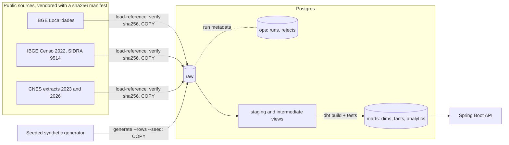

# Data model

A Kimball star schema in Postgres. Flyway owns the landing (`raw`) and run-metadata (`ops`)
schemas; dbt builds `staging` and `intermediate` views and the `marts` tables. The API reads
`marts` and `ops` only. This file is the contract between the dbt project and the API: change a
column here and in both places, in the same PR.

## Flow

## Conventions

- Surrogate keys are `uuid` built from the natural key (`md5(...)::uuid`), so they are stable
  across rebuilds. `dim_date` uses an integer `yyyymmdd` key.
- Every dimension except `dim_date` has one Unknown member with key
  `00000000-0000-0000-0000-000000000000`; facts point to it instead of holding nulls. Its natural
  values: municipality code `0` (state `NA`), CNES code `0000000`, vaccine and dose label
  `UNKNOWN`, sex `U` with a null age band. A CNES unit whose municipality code has no IBGE match
  maps to municipality `0`.
- Seeds (`pni_child_schedule`, `cnes_unit_types`) live in schema `reference`.
- Foreign keys are enforced by dbt `relationships` tests, not database constraints (dbt replaces
  mart tables on each build). Every fact table indexes its foreign-key columns.
- Ages are completed years or days at the event date. Dates are local calendar dates;
  timestamps are `timestamptz` in UTC.

## Dimensions

| Table | Grain | Columns |
| --- | --- | --- |
| `dim_date` | one calendar day, 2015-01-01 to 2030-12-31 | `date_key` int PK, `date_day`, `year`, `quarter`, `month`, `month_name`, `year_month` (`YYYY-MM`), `month_start`, `day_of_month`, `iso_day_of_week`, `day_name`, `iso_week`, `is_weekend` |
| `dim_municipality` | one municipality (flattened: state and region inline) | `municipality_key` PK, `municipality_code` (7-digit IBGE), `municipality_code6` (CNES style), `municipality_name`, `state_code`, `state_abbr`, `state_name`, `region_code`, `region_name` |
| `dim_health_unit` | one CNES unit version (SCD2) | `health_unit_key` PK, `cnes_code`, `unit_name`, `neighborhood`, `municipality_code`, `is_active`, `street`, `unit_type_code`, `unit_type_label`, `latitude`, `longitude` (last five type 1), `valid_from`, `valid_to` (exclusive, `9999-12-31` when current), `is_current` |
| `dim_vaccine` | one vaccine x dose of the childhood schedule | `vaccine_key` PK, `vaccine_code`, `vaccine_name`, `dose_label`, `dose_number`, `recommended_age_days`, `min_age_days`, `max_age_days`, `min_interval_days`, `is_coverage_indicator`, `coverage_target_age_years` |
| `dim_vaccine_lot` | one manufacturing lot | `lot_key` PK, `lot_number`, `vaccine_code`, `manufacturer_name`, `manufactured_on`, `expires_on` |
| `dim_demographic` | sex x completed-year age band 0-6 (junk dimension, 14 rows) | `demographic_key` PK, `sex` (`F`/`M`), `sex_label`, `age_band_years`, `age_band_label` |

SCD2 rules for `dim_health_unit`: versions come from dated CNES extracts in
`raw.cnes_unit_snapshot`. A new version starts when any tracked attribute changes between
consecutive extracts: `unit_name`, `neighborhood`, `municipality_code`, `is_active`. A unit
missing from a later extract gets a version with `is_active = false`. The first version of each
unit is back-dated to the `dim_date` start (assumption: the unit existed before the first
extract). `street`, `unit_type_code` / `unit_type_label` and the coordinates are type 1 (latest
known value on every version): the street format differs between extracts, and the 2023 extract
has no unit type or coordinates.

## Facts

| Table | Grain | Keys | Measures |
| --- | --- | --- | --- |
| `fact_population` | municipality x sex x single-year age (0-6) x census year | `municipality_key`, `demographic_key`, `census_year` | `population` |
| `fact_vaccination` | one dose given to one synthetic person at one unit on one date | `vaccination_id` (degenerate), `person_id` (degenerate), `date_key`, `vaccine_key`, `lot_key`, `health_unit_key` (version valid on the date), `municipality_key`, `demographic_key` (age band at the dose) | `age_days`, `doses` (always 1) |
| `fact_vaccine_receipt` | one lot shipment received by one unit on one date | `receipt_id` (degenerate), `date_key`, `lot_key`, `health_unit_key`, `municipality_key` | `doses_received` |

## Analytics marts (API contract)

`mart_doses_by_state_month`: unique on (`state_abbr`, `year_month`, `vaccine_code`, `dose_label`).

| Column | Type |
| --- | --- |
| `state_abbr` | char(2) |
| `state_name` | text |
| `region_name` | text |
| `year_month` | text, `YYYY-MM` |
| `month_start` | date |
| `vaccine_code` | text |
| `dose_label` | text |
| `doses` | bigint |

`mart_doses_by_age_band`: unique on (`state_abbr`, `year_month`, `vaccine_code`, `sex`,
`age_band_years`).

| Column | Type |
| --- | --- |
| `state_abbr` | char(2) |
| `year_month` | text, `YYYY-MM` |
| `month_start` | date |
| `vaccine_code` | text |
| `sex` | char(1) |
| `age_band_years` | int |
| `doses` | bigint |

`mart_coverage_by_state`: unique on (`state_abbr`, `year`, `vaccine_code`, `dose_label`). Only
coverage-indicator doses.

| Column | Type | Meaning |
| --- | --- | --- |
| `state_abbr` | char(2) | |
| `state_name` | text | |
| `year` | int | year the doses were given |
| `vaccine_code` | text | |
| `dose_label` | text | |
| `target_age_years` | int | age cohort the indicator measures |
| `doses` | bigint | indicator doses given in the year to children of the target age (synthetic) |
| `target_population` | bigint | Censo 2022 population of that age in the state |
| `sample_fraction` | numeric | synthetic persons per birth year / national age-0 population, from the generator run |
| `expected_population` | numeric | `target_population * sample_fraction` |
| `coverage_pct` | numeric(7,2) | `100 * doses / expected_population` |
| `numerator_is_synthetic` | boolean | always true |
| `denominator_source` | text | `IBGE Censo 2022, SIDRA 9514` |

The official indicator divides by live births (SINASC). This warehouse uses a constant census
denominator scaled to the synthetic sample, so `coverage_pct` shows the method, not real coverage.
