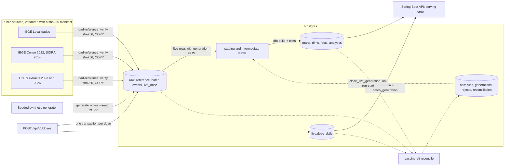

# Data model

A Kimball star schema in Postgres with a speed layer for live doses. Flyway owns the landing
(`raw`), run-metadata (`ops`) and speed (`live`) schemas; dbt builds `staging` and `intermediate`
views and the `marts` tables. The API reads `marts`, `ops` and `live`, and writes only
`raw.live_dose`, `live.dose_daily` and `ops.ingest_reject`. This file is the contract between the
dbt project and the API: change a column here and in both places, in the same PR. The design of
the speed layer is in [WEB_PLATFORM_PLAN.md](WEB_PLATFORM_PLAN.md).

## Flow

## Conventions

- Surrogate keys are `uuid` built from the natural key (`md5(...)::uuid`), so they are stable
  across rebuilds. `dim_date` uses an integer `yyyymmdd` key.
- Every dimension except `dim_date` has one Unknown member with key
  `00000000-0000-0000-0000-000000000000`; facts point to it instead of holding nulls. Its natural
  values: municipality code `0` (state `NA`), CNES code `0000000`, vaccine and dose label
  `UNKNOWN` (also the Unknown lot number), sex `U` with a null age band. A CNES unit whose
  municipality code has no IBGE match maps to municipality `0`.
- Seeds (`pni_child_schedule`, `cnes_unit_types`) live in schema `reference`.
- Foreign keys are enforced by dbt `relationships` tests, not database constraints (dbt replaces
  mart tables on each build). Every fact table indexes its foreign-key columns.
- Ages are completed years or days at the event date. Dates are local calendar dates;
  timestamps are `timestamptz` in UTC.

## Dimensions

| Table | Grain | Columns |
| --- | --- | --- |
| `dim_date` | one calendar day, 2015-01-01 to 2030-12-31 | `date_key` int PK, `date_day`, `year`, `quarter`, `month`, `month_name`, `year_month` (`YYYY-MM`), `month_start`, `day_of_month`, `iso_day_of_week`, `day_name`, `iso_week`, `is_weekend` |
| `dim_municipality` | one municipality (flattened: state and region inline) | `municipality_key` PK, `municipality_code` (7-digit IBGE), `municipality_code6` (CNES style), `municipality_name`, `state_code`, `state_abbr`, `state_name`, `region_code`, `region_name` |
| `dim_health_unit` | one CNES unit version (SCD2) | `health_unit_key` PK, `cnes_code`, `unit_name`, `neighborhood`, `municipality_code`, `is_active`, `street`, `unit_type_code`, `unit_type_label`, `latitude`, `longitude` (last five type 1), `valid_from`, `valid_to` (exclusive, `9999-12-31` when current), `is_current` |
| `dim_vaccine` | one vaccine x dose of the childhood schedule | `vaccine_key` PK, `vaccine_code`, `vaccine_name`, `dose_label`, `dose_number`, `recommended_age_days`, `min_age_days`, `max_age_days`, `min_interval_days`, `is_coverage_indicator`, `coverage_target_age_years`, `coverage_goal_pct` (`numeric(5,2)`, null unless indicator dose; source status to be confirmed), `goal_source` |
| `dim_vaccine_lot` | one manufacturing lot | `lot_key` PK, `lot_number`, `vaccine_code`, `manufacturer_name`, `manufactured_on`, `expires_on` |
| `dim_demographic` | sex x completed-year age band 0-6 (junk dimension, 14 rows) | `demographic_key` PK, `sex` (`F`/`M`), `sex_label`, `age_band_years`, `age_band_label` |

SCD2 rules for `dim_health_unit`: versions come from dated CNES extracts in
`raw.cnes_unit_snapshot`. A new version starts when any tracked attribute changes between
consecutive extracts: `unit_name`, `neighborhood`, `municipality_code`, `is_active`. A unit
missing from a later extract gets a version with `is_active = false`. The first version of each
unit is back-dated to the `dim_date` start (assumption: the unit existed before the first
extract). `street`, `unit_type_code` / `unit_type_label` and the coordinates are type 1 (latest
known value on every version): the street format differs between extracts, and the 2023 extract
has no unit type or coordinates.

## Facts

| Table | Grain | Keys | Measures |
| --- | --- | --- | --- |
| `fact_population` | municipality x sex x single-year age (0-6) x census year | `municipality_key`, `demographic_key`, `census_year` | `population` |
| `fact_vaccination` | one dose given to one synthetic person at one unit on one date (generator events plus absorbed live doses) | `vaccination_id` (degenerate), `person_id` (degenerate), `date_key`, `vaccine_key`, `lot_key` (Unknown for a live dose without a lot), `health_unit_key` (version valid on the date), `municipality_key`, `demographic_key` (age band at the dose) | `age_days`, `doses` (integer, always 1); `record_source` text (`generator` or `live`), `batch_generation` bigint (W, the same on every row) |
| `fact_vaccine_receipt` | one lot shipment received by one unit on one date | `receipt_id` (degenerate), `date_key`, `lot_key`, `health_unit_key`, `municipality_key` | `doses_received` |

## Analytics marts (API contract)

`mart_doses_by_state_month`: unique on (`state_abbr`, `year_month`, `vaccine_code`, `dose_label`).

| Column | Type |
| --- | --- |
| `state_abbr` | char(2) |
| `state_name` | text |
| `region_name` | text |
| `year_month` | text, `YYYY-MM` |
| `month_start` | date |
| `vaccine_code` | text |
| `dose_label` | text |
| `doses` | bigint |

`mart_doses_by_age_band`: unique on (`state_abbr`, `year_month`, `vaccine_code`, `sex`,
`age_band_years`). Doses whose demographic falls back to Unknown keep sex `U` and a null age band,
so the mart still reconciles with the fact.

| Column | Type |
| --- | --- |
| `state_abbr` | char(2) |
| `year_month` | text, `YYYY-MM` |
| `month_start` | date |
| `vaccine_code` | text |
| `sex` | char(1) |
| `age_band_years` | int |
| `doses` | bigint |

`mart_doses_daily`: unique on (`date_day`, `cnes_code`, `vaccine_code`, `dose_label`,
`age_band_years`). The grain of `live.dose_daily` without the generation, so the serving merge is a
plain union. Unknown members map like the other marts: state `NA`, municipality `0`, CNES
`0000000`, vaccine and dose `UNKNOWN`, null age band. Indexes: (`state_abbr`, `date_day`),
(`municipality_code`, `date_day`), (`cnes_code`).

| Column | Type |
| --- | --- |
| `date_day` | date, local calendar date of the dose |
| `state_abbr` | char(2) |
| `municipality_code` | int |
| `cnes_code` | text |
| `vaccine_code` | text |
| `dose_label` | text |
| `age_band_years` | int, null for the Unknown demographic |
| `doses` | bigint |
| `batch_generation` | bigint, W of the fact it was built from, the same on every row |

`mart_coverage_by_state`: unique on (`state_abbr`, `year`, `vaccine_code`, `dose_label`). Only
coverage-indicator doses.

| Column | Type | Meaning |
| --- | --- | --- |
| `state_abbr` | char(2) | |
| `state_name` | text | |
| `year` | int | year the doses were given |
| `vaccine_code` | text | |
| `dose_label` | text | |
| `target_age_years` | int | age cohort the indicator measures |
| `doses` | bigint | indicator doses given in the year to children at most the target age, in completed years (synthetic) |
| `target_population` | bigint | Censo 2022 population of that age in the state |
| `sample_fraction` | numeric | synthetic persons per birth year / national age-0 population, from the generator run |
| `expected_population` | numeric | `target_population * sample_fraction` |
| `coverage_pct` | numeric(7,2) | `100 * doses / expected_population` |
| `numerator_is_synthetic` | boolean | always true |
| `denominator_source` | text | `IBGE Censo 2022, SIDRA 9514` |

`sample_fraction` comes from the latest succeeded `generate` run in `ops.load_run`; without one,
the coverage columns are null and the `coverage_denominator_positive` test fails. Years only
partly covered by the generator window would understate coverage; the default window is two full
calendar years.

The official indicator divides by live births (SINASC). This warehouse uses a constant census
denominator scaled to the synthetic sample, so `coverage_pct` shows the method, not real coverage.

`mart_coverage_target_by_municipality`: unique on (`municipality_code`, `vaccine_code`,
`dose_label`). The coverage denominator per municipality, one row per municipality (Unknown
excluded) and coverage-indicator dose, zeros included. It does not depend on the year: the API
divides doses by `expected_population` for any year, live-only years included.

| Column | Type | Meaning |
| --- | --- | --- |
| `municipality_code` | int | 7-digit IBGE code |
| `state_abbr` | char(2) | |
| `vaccine_code` | text | |
| `dose_label` | text | |
| `target_age_years` | int | age cohort the indicator measures |
| `target_population` | bigint | Censo 2022 population of that age in the municipality, both sexes; 0 without census rows |
| `sample_fraction` | numeric | same value as in `mart_coverage_by_state` (latest succeeded `generate` run) |
| `expected_population` | numeric | `target_population * sample_fraction` |
| `numerator_is_synthetic` | boolean | always true |
| `denominator_source` | text | `IBGE Censo 2022, SIDRA 9514` |

Per state, `sum(target_population)` equals `mart_coverage_by_state.target_population` and
`sum(expected_population)` equals its `expected_population`; the singular test
`coverage_target_sums_to_state` checks it. Boa Esperança do Norte (MT, `5101837`, created after
Censo 2022) has no census rows, so its denominator is 0.

## Synthetic events

`vaccine-elt generate --rows N --seed S --start D --end D` writes `raw.vaccination_event`,
`raw.vaccine_lot` and `raw.vaccine_receipt` in one transaction (TRUNCATE + COPY); the same seed and
snapshots give identical rows. Rules (constants in `elt/src/vaccine_elt/generator/core.py`):

- Each synthetic person has a home municipality drawn in proportion to its Censo 2022 population
  aged 0 (municipalities with at least one active unit), a home unit drawn among the units active
  at the window start, a sex drawn from the municipality's census ratio, and a birth date that
  makes them 0-6 years old during the window. Every dose of a person is given at the home unit.
- For each vaccine series of `dbt/seeds/pni_child_schedule.csv`: the first dose is taken with a
  seeded per-state probability (82-97%), each next dose with 96%. The age at a dose is the
  recommended age plus a seeded delay (exponential, mean 12 days), at least the minimum age and the
  minimum interval after the previous dose; past the maximum age the series stops. Only doses
  inside the window are recorded, so the first doses of older children are not in the data.
- One lot per vaccine per calendar quarter; one receipt per unit, vaccine and quarter, on the
  quarter's first business day, covering that quarter's doses plus 5-15% wastage in packs of 10.
- `sample_fraction` = synthetic persons per birth year / national population aged 0.
- The window must end before the next CNES extract after its start, so unit states (and therefore
  the point-in-time join of the facts) do not change inside it.

With 200,000 events the sample is about 0.2% of a birth cohort. Each person stays at one home unit,
so doses reach about 17,000 of the 54,000 eligible units, each with a handful of doses, and
receipts are almost as many as doses.

## Speed layer (live doses)

Doses posted to `POST /api/v1/doses` are available to the dashboards at once and are absorbed by
the next dbt run. Migrations `V6` and `V7` own the objects.

- `raw.live_dose`: one accepted dose, append-only. `event_id` uuid PK (server-generated),
  `generation`, `client_id`, `idempotency_key`, `request_sha256`, `person_id`, `birth_date`, `sex`,
  `cnes_code`, `vaccine_code`, `dose_label`, `lot_number` (nullable), `administered_at`,
  `received_at`. Unique on (`client_id`, `idempotency_key`) and on (`person_id`, `vaccine_code`,
  `dose_label`).
- `live.dose_daily`: incremental aggregate updated in the same transaction as the landing row.
  PK (`generation`, `administered_on`, `cnes_code`, `vaccine_code`, `dose_label`,
  `age_band_years` 0-6); `municipality_code`, `state_abbr` (from the unit version valid on the
  date), `doses`, `updated_at`. `administered_on` is the local date (America/Sao_Paulo) of
  `administered_at`, the rule of `stg_live__doses`.
- `ops.ingest_reject`: one row per refused POST (4xx), with a reason code and no payload.
- `ops.live_generation` (the open generation G, one row) and `ops.live_generation_close` (one row
  per closed generation, with the dbt invocation id).

Generation protocol:

1. Every dose lands with the open generation G, read inside its insert transaction after
   `LOCK TABLE raw.live_dose IN ROW EXCLUSIVE MODE`.
2. `ops.close_live_generation(closed_by)` takes `SHARE` on `raw.live_dose`, so it waits for every
   in-flight ingest and blocks new ones until it commits; then it bumps G and records the closed
   value W. After the commit, every row with `generation <= W` is committed and no later row can
   get such a generation. Readers are never blocked.
3. dbt closes a generation once per `dbt run` or `dbt build` (`on-run-start`; other commands run
   `select 1`). `stg_live__generation_watermark` reads W = `coalesce(max(generation), 0)` from
   `ops.live_generation_close`; `int_vaccinations_enriched` adds the live rows with
   `generation <= W` (`record_source = 'live'`) to the generator events and stamps W on every row
   as `batch_generation`. The fact and `mart_doses_daily` are each one statement, so the W stored
   with the rows is the W of the rows absorbed. `on-run-end` sends
   `pg_notify('batch_event', {generation, invocationId})` after a build without errors.
4. Serving merges in one statement: `marts.mart_doses_daily` plus `live.dose_daily` rows with
   `generation > (select max(batch_generation) from the mart)` (0 for an empty mart). A mart swap
   is atomic, so there is no double count and no gap during a build.

## Reconciliation

`marts_reconcile_with_raw` (dbt test, every build): the fact, `mart_doses_by_state_month`,
`mart_doses_by_age_band` and `mart_doses_daily` each hold the raw generator events plus the live
rows with `generation <=` the fact's own `batch_generation`, and a non-empty fact has exactly one
`batch_generation`. `receipts_cover_applications` counts only `record_source = 'generator'`
(live doses carry no stock).

`vaccine-elt reconcile` (`make reconcile`, part of `make demo`): both checks run in one
`REPEATABLE READ READ ONLY` transaction, so ingest continues; the results are written afterwards in
a separate transaction. Exit code 1 when a check fails. The run is an `ops.load_run` row (command
`reconcile`, status `failed` when a check failed).

| Check | Compares | Grain |
| --- | --- | --- |
| `live_aggregate_matches_landing` | `live.dose_daily` vs `raw.live_dose` | generation, local date, CNES unit, vaccine, dose, age band |
| `serving_matches_landing` | `marts.mart_doses_daily` + `live.dose_daily` above the mart's `batch_generation` vs `raw.vaccination_event` + `raw.live_dose` | local date, vaccine, dose |

In `serving_matches_landing`, vaccine and dose pairs missing from `marts.dim_vaccine` are mapped to
`UNKNOWN` on both sides, the rule `fact_vaccination` applies, so a code outside the schedule is not
reported as a lost dose.

- `ops.reconciliation_check`: PK (`run_id`, `check_name`), `batch_generation`, `open_generation`,
  `keys_compared`, `keys_mismatched`, `expected_total`, `actual_total`, `passed`.
- `ops.reconciliation_diff`: PK (`run_id`, `check_name`, `line_no`), `diff_key` jsonb, `expected`,
  `actual`; at most 100 rows per check.

## API mapping

Roles: P = profissional, G = gestor, A = data-admin, I = dose-ingest (service). Scope: S = rows
restricted to the caller's `region_scope` claim (`BR`, `UF:<abbr>`, `MUN:<7-digit IBGE>`) and a
`region` parameter must lie inside it (403 `region_out_of_scope`); S>=UF = same at state grain,
municipality callers get 403; a token without a valid `region_scope` gets 403 `missing_region_scope`.
Without a token every endpoint except health, `/v3/api-docs` and Swagger UI answers 401.

| Endpoint | Roles | Scope | Reads |
| --- | --- | --- | --- |
| `POST /api/v1/doses` | I | none | writes `raw.live_dose`, `live.dose_daily`, `ops.ingest_reject` (client id = token `azp`); validates against `marts.dim_vaccine` and `marts.dim_health_unit` |
| `GET /api/v1/me` | P G A | none | the token: username, name, roles, scope `{level, state, municipalityCode, label}` |
| `GET /api/v1/dashboard/summary` | P G A | S | `marts.mart_doses_daily` + `live.dose_daily` above `batch_generation` (merged) |
| `GET /api/v1/dashboard/doses/timeseries` | P G A | S | same merge, grouped by day, week or month |
| `GET /api/v1/dashboard/doses/by-vaccine` | P G A | S | same merge, grouped by vaccine and dose, joined to `marts.dim_vaccine`; small municipality cells suppressed |
| `GET /api/v1/dashboard/doses/by-age-band` | P G A | S | same merge, grouped by `age_band_years` (null = Unknown) |
| `GET /api/v1/dashboard/map` | P G A | S (state level: S>=UF) | same merge per state or municipality of `marts.dim_municipality`; coverage divides by `marts.mart_coverage_target_by_municipality.expected_population` (state = sum), numerator limited to `age_band_years <= coverage_target_age_years` |
| `GET /api/v1/dashboard/health-units` | P G A | S | `marts.dim_health_unit` (current, active) of one municipality left-joined to the same merge by `cnes_code` |
| `GET /api/v1/reference/regions` | P G A | S | `marts.dim_municipality` without the Unknown member: states, or the municipalities of `state` |
| `GET /api/v1/reference/vaccines` | P G A | none | `marts.dim_vaccine` without the Unknown member |
| `GET /api/v1/exports/{doses-daily,coverage-municipality,health-units}` | G | S | the same queries as the dashboard endpoints, as CSV (decision 53) |
| `GET /api/v1/stream` | P G A | S | `text/event-stream` fed by `LISTEN dose_event, batch_event`; filtered by the token scope and optional `region`; closes at token expiry (at most 30 min) |
| `GET /api/v1/doses/by-state-month` | P G A | S>=UF | `marts.mart_doses_by_state_month` |
| `GET /api/v1/doses/by-age-band` | P G A | S>=UF | `marts.mart_doses_by_age_band` |
| `GET /api/v1/coverage` | P G A | S>=UF | `marts.mart_coverage_by_state` |
| `GET /api/v1/health-units/{cnesCode}/history` | P G A | S (every version's municipality) | `marts.dim_health_unit` joined to `marts.dim_municipality` |
| `GET /api/v1/runs/latest` | A | none | `ops.load_run`, `ops.load_run_table` |

The Java records in `src/main/java/.../analytics/AnalyticsRows.java` and the test fixtures in
`src/test/resources/fixtures/marts.sql` mirror these columns.
